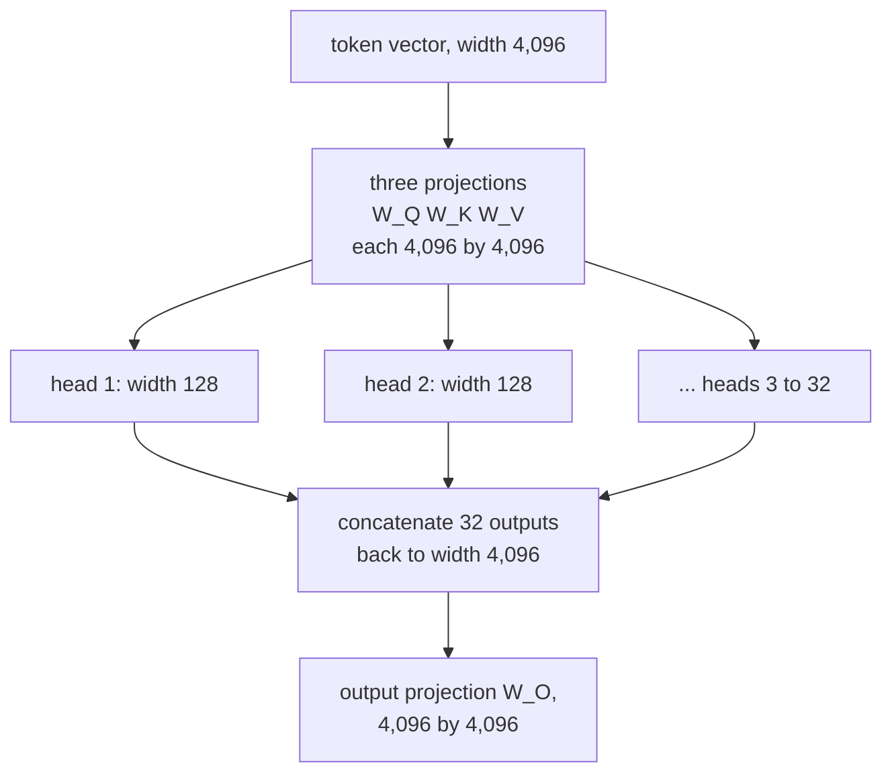

A word's meaning depends on the words around it, so a program reading text has to let each word borrow meaning from its neighbours. A **token** is one unit of text the model reads, usually a word or a piece of one, and a token's **context** is the other tokens it can see. **Attention** is the step inside a language model that does the borrowing. For every token it scores how relevant each other token is, turns the scores into weights that add to one, and replaces the token's representation with a weighted average of what those other tokens carry. The weights are computed from the tokens themselves, so the same word reads different neighbours in different sentences, as the figure shows for "bank" in a sentence about a river and a sentence about money.

Attention has one blind spot that the second half of this note repairs. The weighted average treats its inputs as an unordered set, so on its own it cannot tell "dog bites man" from "man bites dog". Position information has to be added, and the three common ways to add it are adding a position vector to each token, rotating the vectors by an angle that grows with position, and subtracting a penalty that grows with distance. Each choice decides how a model behaves when it meets a text longer than any it was trained on.

Every later section changes one of three things in the same pipeline. Sections 2 to 5 build the score and the average, sections 6 to 9 decide what position information reaches the score, and sections 10 and 11 count what the $n \times n$ table of scores costs.

---

## 1. Mixing information across positions

A sentence has to be read as a whole, since a word's meaning often depends on a word several places away. In "the animal did not cross the street because it was tired", the word "it" means the animal, and in "because it was wide" it means the street. A **neural network** is a function built from many learned numbers, its **parameters**, adjusted during training so its outputs improve. Inside a language model every token is held as a **vector**, a list of a few thousand numbers, and a layer's job is to update each token's vector using the others.

The simplest fix is a fixed window, where each word averages the vectors of its two neighbours with equal weight. That fails twice. The useful word may sit outside the window, and inside the window "the" gets the same weight as "river" although only "river" changes what "bank" means. Attention replaces the fixed window with weights the model computes for each pair from the content of the two tokens, over every position it is allowed to see. The [Transformer paper](https://arxiv.org/abs/1706.03762) built a whole architecture from this operation, and every model in this series is a stack of such layers.

The opening figure shows the effect on toy vectors with three features meaning money, water and grammar. The same query from "bank" puts 0.36 of its weight on "river" in one sentence and 0.31 on "cash" in the other, so the averaged vector leans toward water in the first case and money in the second. A real model learns its features and uses many such reads in parallel, but the mechanism is the same.

## 2. Queries keys and values

Attention gives each token three roles, which is easiest to see with a library search. You type a question, each book has a catalogue entry describing it, and when an entry matches you read the book's contents. The **query** $q_i$ is the question token $i$ asks, the **key** $k_j$ is the catalogue entry token $j$ shows, and the **value** $v_j$ is the content token $j$ hands over. Each is made by a **projection**, multiplying the token vector by a learned **matrix**, a rectangular table of numbers: $q_i = x_iW_Q$, $k_j = x_jW_K$ and $v_j = x_jW_V$. Multiplying a row vector by a matrix means each output number is the sum of the vector's entries times one column of the matrix.

$$
s_{ij} = \frac{q_i \cdot k_j}{\sqrt{d_k}}, \qquad a_{ij} = \frac{e^{s_{ij}}}{\sum_{j'} e^{s_{ij'}}}, \qquad o_i = \sum_j a_{ij}\, v_j
$$

The **dot product** $q_i \cdot k_j$ multiplies matching entries and adds them, so it is large when the two vectors point the same way. Here $s_{ij}$ is the **score** of position $j$ for position $i$, $d_k$ is the **head width**, the number of entries in each query and key, and section 3 explains the division by $\sqrt{d_k}$. **Softmax** is the middle formula: raise $e \approx 2.718$ to each score and divide by the sum, which makes every **attention weight** $a_{ij}$ positive, keeps the scores' order, and makes the weights in a row add to 1. The **output** $o_i$ is the weighted average of the values, and $j'$ just runs over every position $i$ may read.

### A complete calculation on three tokens

Take the phrase "the river bank" with two numbers per token so every step fits on paper. The token vectors are $x_{the} = (0,1)$, $x_{river} = (1,0)$ and $x_{bank} = (1,1)$. The projection matrices have rows $W_Q = [(0,1),(1,0)]$, $W_K = [(1,1),(-1,0)]$ and $W_V = [(2,0),(0,1)]$. These are chosen teaching numbers, while a trained model learns its matrices.

1. Project every token. The queries are the $(1,0)$, river $(0,1)$ and bank $(1,1)$. The keys are the $(-1,0)$, river $(1,1)$ and bank $(0,1)$. The values are the $(0,1)$, river $(2,0)$ and bank $(2,1)$. For example bank's query is $1 \times (0,1) + 1 \times (1,0) = (1,1)$.
2. Score bank's query against every key. Against the: $1 \times (-1) + 1 \times 0 = -1$. Against river: $1 + 1 = 2$. Against bank itself: $0 + 1 = 1$.
3. Divide by $\sqrt{2} \approx 1.4142$, the square root of the head width 2, giving $-0.7071$, $1.4142$ and $0.7071$.
4. Exponentiate: $0.4931$, $4.1133$ and $2.0281$, which add to $6.6344$.
5. Divide by that sum. The weights are 0.0743 for the, 0.6200 for river and 0.3057 for bank, and they add to 1.
6. Average the values: $0.0743 \times (0,1) + 0.6200 \times (2,0) + 0.3057 \times (2,1) = (1.8514, 0.3800)$.

The new vector for bank is mostly river's value $(2,0)$, so after this layer bank carries information about the word beside it. The query, key and value come from three separate matrices because the three roles differ. River should be easy to find when bank asks about water, which is the key's job, and what it hands over can be a different summary, which is the value's job. The animation replays these steps.

<video class="cm-figure-video" src="/images/llm-fundamentals/15c-qkv-walkthrough.mp4" autoplay loop muted playsinline controls preload="metadata" aria-label="Qkv walkthrough"></video>

## 3. Scaling by the square root of head width

A dot product adds up one product per entry, so wider vectors give bigger sums for the same kind of agreement. Think of judging a match by summing points across survey questions: a 64-question survey produces bigger totals and bigger gaps between candidates than a 4-question survey, even when the candidates are equally different. **Variance** measures how spread out a quantity is around its average, as the average squared distance from it, and the **standard deviation** is its square root. If each entry of a query and a key has average 0 and variance 1, and the entries are independent, each product also has variance 1, and the sum of $d_k$ of them has variance $d_k$ and standard deviation $\sqrt{d_k}$.

Width changes how peaked the [softmax](/tutorials/llm-fundamentals/language-modeling-and-next-token-prediction/#5-logits-and-softmax) gets. Take two keys whose scores differ by one standard deviation. At width 4 the gap is 2, and the winner gets $e^2/(e^2+1) = 0.881$ of the weight. At width 64 the gap is 8 and the winner gets 0.9997, so attention has become a hard pick of one key. At the 7B model's width of 128 the gap is 11.3 and the winner gets 0.99999. Dividing every score by $\sqrt{d_k}$ brings the gap back to 1, and the winner gets 0.731 at any width.

The peaked case hurts training, which adjusts each parameter in the direction that reduces the error, a direction found from the **gradient**, the rate at which the error changes as each number changes. For two keys the gradient through softmax is proportional to $a(1-a)$, where $a$ is the winner's weight. That is 0.197 at $a = 0.731$ and 0.0003 at $a = 0.9997$, so a saturated softmax passes back almost no signal and the scores stop learning. The figure repeats the experiment with 16 keys. Without scaling the largest weight climbs from 0.42 at width 4 to 0.89 at width 128, while with scaling it stays near 0.25. The argument assumes unit-variance entries, which trained models only roughly have, so some models add a learned temperature or normalize queries and keys instead. Architecture works the gradient version of this argument further.

## 4. The causal mask

A model that writes text one token at a time must not peek at the word it is about to write. A student practicing dictation with the answer sheet face up learns nothing, and a model trained the same way learns to copy instead of predict. **Autoregressive generation** means producing text one token at a time, each chosen from everything before it, and the language model of [Language Modeling and Next Token Prediction](/tutorials/llm-fundamentals/language-modeling-and-next-token-prediction/) is trained to predict every next token of a training text in parallel. A **causal mask** makes that parallel training honest: position $i$ may read positions $j \le i$ and nothing later.

$$
a_{ij} = \operatorname{softmax}_j\left(s_{ij} + M_{ij}\right), \qquad M_{ij} = \begin{cases} 0 & j \le i \\ -\infty & j > i \end{cases}
$$

The mask entry $M_{ij}$ is added to the score before softmax. A score of $-\infty$ has exponential $e^{-\infty} = 0$, so a future position gets weight exactly zero and the remaining weights still add to 1, with $\operatorname{softmax}_j$ meaning the normalization runs over $j$ in one row. Arranged as a grid with one row per query position, the allowed cells form a lower triangle.

Apply it to section 2's phrase. The row for "the" may read only itself, so its weight is 1 and its output is its own value $(0,1)$. The row for "river" reads the and river with scores $0$ and $1/\sqrt{2} = 0.7071$, so its weights are 0.3302 and 0.6698 and its output is $(1.3395, 0.3302)$. The row for "bank" sits last, so it reads everything and keeps its section 2 output $(1.8514, 0.3800)$.

A **future perturbation test** checks that a mask works: change a later token and confirm that no earlier output moves. Changing bank's value from $(2,1)$ to $(5,5)$ moves bank's own output by 2.14 summed over its two numbers, and moves the and river by exactly 0. With the mask removed the same edit moves the's output by 1.99 and river's by 2.81, which is how a leak through a broken mask would show up. A suspiciously low training loss is often the first symptom.

## 5. Multi head attention

One set of weights per token can only answer one question at a time, while a word usually needs several answered. For "it" in a long sentence, one question is which noun it refers to and another is what verb comes next. **Multi-head attention** runs $h$ attention operations side by side, each called a **head**, with its own query, key and value projections, so each head can learn its own notion of relevance.

The heads split the model width instead of adding to it. A token vector of width $d$ is projected to queries, keys and values of width $d$, and each is cut into $h$ slices of width $d_k = d/h$. In a toy with $d = 4$ and $h = 2$, a query $(1, 0, 2, 1)$ becomes head 1's query $(1,0)$ and head 2's query $(2,1)$, and each head runs section 2's calculation on its own slice. In the 7B model, $d = 4{,}096$ splits into $h = 32$ heads of $d_k = 128$. The 32 head outputs of width 128 are placed side by side, giving width 4,096 again, and an **output projection** $W_O$ mixes them so information found by one head can reach every coordinate.

The parameter count follows from the four square matrices. Each of $W_Q, W_K, W_V, W_O$ is $4{,}096 \times 4{,}096 = 16{,}777{,}216$ numbers, so one layer's attention holds $4d^2 = 67{,}108{,}864$ parameters, and Llama 2 uses no bias terms that would add to it. Across $L = 32$ layers that is 2,147,483,648, about 32% of the model's 6.74 billion. The count does not depend on $h$, since 32 heads of 128 and one head of 4,096 use the same four matrices cut differently. The head count changes what the layer can represent, with more heads giving more independent patterns of narrower width. [The Transformer Block and Model Anatomy](/tutorials/llm-fundamentals/the-transformer-block-and-model-anatomy/) places this layer inside the full block.

## 6. Permutation equivariance

Attention, as built so far, has no idea where any token sits. Shuffle a deck of cards, deal them, and a dealer who only looks at faces will treat each card the same whatever its place in the deck. **Permutation equivariance** means that reordering the inputs reorders the outputs in exactly the same way and changes nothing else. Without a mask, attention has this property, because each output is a weighted sum over a set, and every score depends only on the two vectors involved.

Check it with section 2's numbers and no mask. Swap the first two tokens to get "river the bank". Bank's query is still $(1,1)$ and it meets the same three keys, now in a different order, so its weights are still 0.6200 on river, 0.0743 on the and 0.3057 on itself, and its output is still $(1.8514, 0.3800)$. The outputs for the and river swap places along with their inputs, and none of the numbers change. The projections and the later per-token layers treat every position identically too, so the whole stack inherits the property.

So "dog bites man" and "man bites dog" contain the same three tokens and would give every token the same output vector, though the two sentences mean different things. The causal mask breaks the symmetry slightly, since position 5 sees five tokens and position 2 sees two, and some decoder models trained without any position scheme do learn rough positions from that, as [NoPE](https://arxiv.org/abs/2305.19466) reports. Most models still add position information explicitly, by one of the schemes in sections 7 to 9. Positional Encoding and Long Context draws the same failure on real attention scores.

## 7. Absolute and sinusoidal positions

The most direct repair is to stamp each token with its seat number. A **position encoding** is any signal that lets the computation depend on where a token sits, and an **absolute position embedding** does it by adding a vector $P_i$ to the token vector, so the layer receives $x_i + P_i$. The simplest version is a **learned position table**, one trained row per position. GPT-2 has 1,024 rows, which also makes 1,024 a hard limit, since position 1,025 has no row to look up.

The original Transformer used a fixed **sinusoidal encoding** instead, built from sine and cosine waves of many speeds. Coordinates come in pairs, and pair $t$ turns at **frequency** $\omega_t = 10{,}000^{-2t/d}$:

$$
P_{i,2t} = \sin(i\,\omega_t), \qquad P_{i,2t+1} = \cos(i\,\omega_t)
$$

Here $i$ is the position, $t$ numbers the pair from 0, and $d$ is the vector width. The fast pairs change a lot between neighbours and the slow pairs barely move across thousands of positions, so together they read like the hands of a clock. Take $d = 4$, so the two frequencies are $\omega_0 = 1$ and $\omega_1 = 10{,}000^{-1/2} = 0.01$. Position 1 gets $(\sin 1, \cos 1, \sin 0.01, \cos 0.01) = (0.841, 0.540, 0.010, 1.000)$ and position 2 gets $(0.909, -0.416, 0.020, 1.000)$.

The dot product of two such vectors depends only on the gap between positions. By the identity $\sin a \sin b + \cos a \cos b = \cos(a-b)$, each pair contributes $\cos((i-j)\omega_t)$. For positions 1 and 2 that is $\cos 1 + \cos 0.01 = 0.540 + 1.000 = 1.540$, the same as for positions 101 and 102. The figure plots this similarity at width 128, where it falls from 1 at offset 0 to 0.97 at offset 1 and 0.71 at offset 8, with the same curve starting from position 100 or 1,000.

The relative structure gets blurred once the position vector is added to content. The query becomes $(x_i + P_i)W_Q$, so a score mixes content with content, content with position, and position with position, and the model must learn to separate them. **Relative position** schemes put the offset $i - j$ into the score directly, and the next two sections are the two most used.

## 8. Rotary position embedding

Think of two clock hands that both start at their own angle and both advance by the same amount each hour. Whatever the hour, the angle between them stays the same. **Rotary position embedding**, or RoPE from the [RoFormer paper](https://arxiv.org/abs/2104.09864), uses that fact. It splits each query and key into pairs of coordinates and rotates each pair by an angle proportional to the token's position, $i\theta$ for the query at position $i$ and $j\theta$ for the key at position $j$. A **rotation** $R(\alpha)$ turns a two-number vector by angle $\alpha$ and keeps its length.

$$
\big(R(i\theta)\,q\big) \cdot \big(R(j\theta)\,k\big) = q \cdot R\big((j-i)\theta\big)\,k
$$

Here $q$ and $k$ are one coordinate pair of the query and key before rotation, and $\theta$ is the angle added per position. The left side is the score after both rotations, and the right side contains positions only through the offset $j - i$, so the score sees how far apart the tokens are and never where they sit. Rotating both vectors by the same extra angle leaves the angle between them, and so the dot product, unchanged.

### A rotation worked to numbers

Use $\theta = 45°$, a raw query pair $q = (1,2)$ and a raw key pair $k = (3,2)$. Before rotation the score is $1 \times 3 + 2 \times 2 = 7$.

1. Query at position 2 turns by 90° to $(-2, 1)$. Key at position 1 turns by 45° to $(0.7071 \times (3-2),\ 0.7071 \times (3+2)) = (0.71, 3.54)$. The score is $-2 \times 0.71 + 1 \times 3.54 = 2.121$.
2. Move both two positions later, to 4 and 3. The query becomes $(-1,-2)$ and the key $(-3.54, 0.71)$, which are new directions, and the score is $3.54 - 1.41 = 2.121$ again.
3. At positions 6 and 5 the score is 2.121 once more, because the offset is still 1.
4. Move only the key back to position 4. The offset becomes 2, the angle between the vectors opens from 75° to 120°, and the score falls to $-4$. At positions 6 and 6 the rotations cancel and the score returns to 7.

<video class="cm-figure-video" src="/images/llm-fundamentals/15c-rope-relative-angle.mp4" autoplay loop muted playsinline controls preload="metadata" aria-label="Rope relative angle"></video>

A real head rotates many pairs at different speeds. Llama 2 uses RoPE with head width 128, so 64 pairs, and pair $t$ turns by $\omega_t = 10{,}000^{-2t/128}$ radians per position. The fastest pair turns 1 radian per token and repeats every 6.3 tokens, while the slowest turns 0.000115 radians per token and repeats only every 54,410 tokens. Fast pairs separate neighbours and slow pairs separate distant tokens, the same clock design as section 7. RoPE rotates only queries and keys, so the values carry content alone, and it is applied in every layer instead of once at the input.

## 9. ALiBi and length extrapolation

A simpler idea is to tell each head "trust nearby words more" directly. A person skimming a long thread gives a reply right above more weight than one twenty messages back, and does so the same way whether the thread has 50 messages or 500. **ALiBi**, attention with linear biases from [Press and colleagues](https://arxiv.org/abs/2108.12409), adds no position vector at all. It subtracts a penalty proportional to distance from each score, $s_{ij} - m\,(i-j)$, where $m$ is the head's **slope**. Different heads get different slopes, a geometric series $1/2, 1/4, \ldots, 1/256$ for 8 heads, so some heads stay local and some look far.

Work the slopes through. A head with slope $1/2$ subtracts 2.5 from a key five tokens back, which multiplies that key's unnormalized weight by $e^{-2.5} = 0.082$. A head with slope $1/8$ subtracts 0.625 at the same distance, a factor of 0.54. The penalty is a simple rule defined at every distance, so a sequence longer than training needs nothing new. The paper reports a model trained on 1,024 tokens that matched, at 2,048 tokens, a sinusoidal model trained on 2,048.

**Length extrapolation** is a model's ability to work on inputs longer than its **trained context length** $n_{train}$, and most schemes are poor at it. A learned table has no rows past its end. Sinusoidal and rotary encodings still produce numbers, but the slow pairs reach angles training never showed. With rotary position embedding (RoPE) in the 7B model, the slowest pair has turned at most $4{,}096 \times 0.000115 = 0.47$ radians by the end of training, and at position 16,384 it reaches 1.89 radians. The attention layers have never seen keys rotated that far, so scores become erratic. **Perplexity**, the exponential of the average per-token prediction loss defined in [Language Modeling and Next Token Prediction](/tutorials/llm-fundamentals/language-modeling-and-next-token-prediction/), typically shoots up within a few hundred tokens past $n_{train}$.

**Position interpolation**, from [Chen and colleagues](https://arxiv.org/abs/2306.15595), avoids the unseen angles by squeezing positions. To run at 16,384 tokens, multiply every position by $4{,}096 / 16{,}384 = 1/4$, so position 16,000 rotates like position 4,000, a range the model knows. Neighbours now differ by a quarter step, so the model needs a short **fine-tuning** run, meaning more training on the new setting, and the paper reports about 1,000 steps. ALiBi extrapolates more gracefully but its far heads still attend weakly to distant tokens, so most current open models use RoPE with some form of interpolation. Positional Encoding and Long Context and Document Level LLMs cover the extension methods in depth.

## 10. Quadratic cost and the key value cache

Attention compares every token with every other token, so a text twice as long has four times as many pairs. A round of introductions at a party with 10 guests takes 45 handshakes, and with 20 guests it takes 190. For $n$ tokens one head computes $n^2$ scores, or $n(n+1)/2$ under the causal mask, which is still on the order of $n^2$. At $n = 4{,}096$ that is 16,777,216 scores per head per layer.

Storing the full score table for one layer of the 7B model takes $32$ heads $\times\ 4{,}096^2$ scores $\times\ 2$ bytes $= 1$ GiB, where a GiB is $2^{30}$ bytes. At 32,768 tokens it takes $8^2 = 64$ times as much, 64 GiB per layer. FlashAttention computes the same result in small tiles without ever storing the table, which Efficient Attention Mechanisms explains, but the arithmetic stays quadratic.

The arithmetic shows up when the model writes a new token. A **FLOP** is one floating-point arithmetic operation, and a multiply followed by an add counts as two. The new token's query is compared with every earlier key and averages every earlier value, costing $2nd$ FLOPs each, so $4nd$ per layer. The layer's weights cost a fixed $2 \times 202{,}383{,}360 = 404.8$ million [FLOPs per token](/tutorials/llm-fundamentals/the-transformer-block-and-model-anatomy/#9-flops-per-token). At 4,096 tokens attention adds 67 million, 17% of the weight work. At 32,768 it adds 537 million, 133%, and the two are equal at about 24,705 tokens.

Memory grows too, because the model keeps every earlier key and value instead of recomputing them for each new token. This store is the **key value cache**. Per token it holds $2 \times L \times h_{kv} \times d_k \times b$ bytes, where 2 counts keys and values, $L = 32$ layers, $h_{kv} = 32$ key value heads, $d_k = 128$ and $b = 2$ bytes. That is 524,288 bytes, or 0.5 MiB per token, where a MiB is $2^{20}$ bytes. A 4,096-token conversation needs 2 GiB and a 32,768-token one needs 16 GiB, more than the model's 12.55 GiB of weights. [Inference and Decoding](/tutorials/llm-fundamentals/inference-and-decoding/) shows how this cache, more than arithmetic, limits generation speed.

## 11. Head sharing and design selection

The cache in section 10 stores one key and one value for every head, but the heads do not need private copies. A study group can share one set of library books and still take different notes from them. **Multi-query attention**, or MQA from [Shazeer](https://arxiv.org/abs/1911.02150), keeps all the query heads but gives them one shared key head and value head, so $h_{kv} = 1$. **Grouped-query attention**, or GQA from [Ainslie and colleagues](https://arxiv.org/abs/2305.13245), sits between: query heads are split into $h_{kv}$ groups that each share one key value head. With the 7B shapes and $h_{kv} = 8$ the cache drops from 0.5 MiB to 128 KiB per token, so 512 MiB at 4,096 tokens. With MQA it is 16 KiB per token. [Llama 2](https://arxiv.org/abs/2307.09288) 70B uses 8 key value heads, while the 7B model keeps full multi-head attention. The score arithmetic does not shrink, because every query head still reads every cached key, and Efficient Attention Mechanisms works through the quality tradeoff.

The choices in this note reduce to a few decisions a model designer actually makes.

| Situation | Choice | Reason |
|---|---|---|
| New decoder model trained from scratch | Scaled dot-product attention, causal mask, RoPE | Relative positions and a well-tested route to longer context |
| Need to serve contexts 4 times longer than $n_{train}$ | RoPE with position interpolation and a short fine-tune | Keeps every rotation angle inside the trained range |
| Must handle longer inputs with no further training | ALiBi or a similar distance bias | The penalty is defined at any distance |
| Generation memory dominated by the cache | GQA with about 8 key value heads | Cuts cache size by $h / h_{kv}$ with small quality loss |
| Training loss suspiciously low | Future perturbation test on the mask | A leak lets the model copy the answer |
| Attention arithmetic dominates at long context | FlashAttention or sparse attention, see 14a | The pair count grows with $n^2$ |

