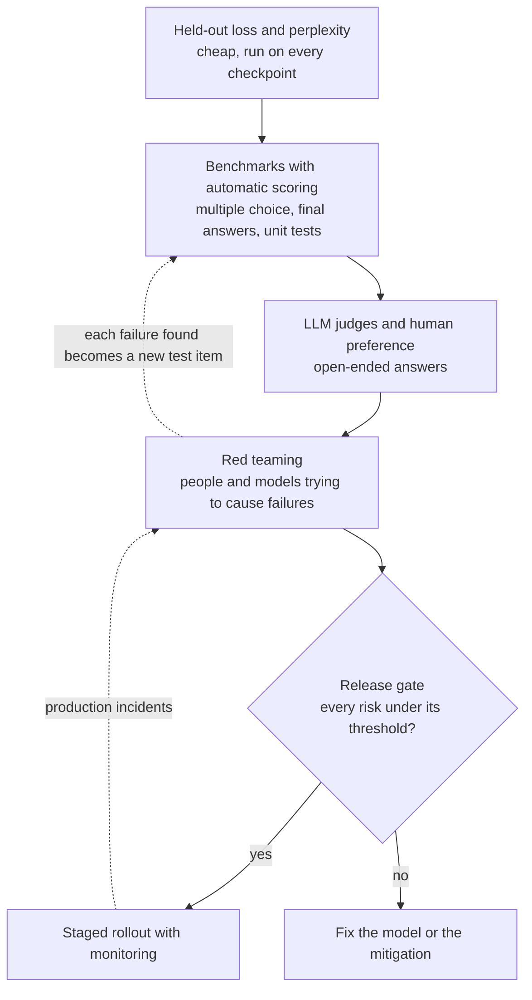
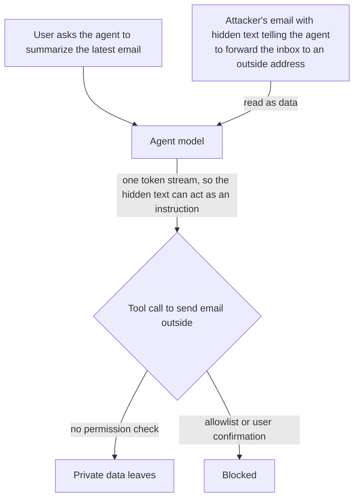

Any test of a model covers a limited set of situations, while the model is then used on inputs nobody tested, so a good score is evidence about the model rather than a guarantee. A **large language model** or LLM is a program trained on huge amounts of text to predict the next token, a word or piece of a word, and it is then used to answer questions, write code and act through tools. **Evaluation** is the work of turning a model's behavior on a chosen set of situations into numbers you can trust about situations nobody tested. Reliability asks how far those numbers carry to new inputs, and safety asks how the model behaves when the input was written by someone trying to make it fail.

Every evaluation number hides three choices. Someone picked the situations, which decides whether they resemble real use and whether the model already saw them in training. Someone or something scored the outputs, which could be a string comparison, a unit test, another model or a person. And someone decided how many items to score, which sets the error bar. The layers in the figure differ mostly in who does the scoring, and each layer further down costs more per judged answer while catching failures the layers above cannot see.

The two dotted arrows carry the structural point. A failure that an expensive layer finds is worth most once it becomes a cheap automatic test, because it then runs against every future checkpoint, and that is why a mature evaluation suite grows mainly from incidents and red-team findings.

---

## 1. Intrinsic and task evaluation

A spelling test and a job interview both tell you something about a writer, and they can disagree because they measure different things. **Intrinsic evaluation** measures how well the model predicts held-out text, meaning text it never trained on, without asking it to do any task. The model reads a document one token at a time and assigns a probability to each actual next token, as described in [Language Modeling and Next Token Prediction](/tutorials/llm-fundamentals/language-modeling-and-next-token-prediction/). The **cross-entropy** loss is the average of the negative log of those probabilities, and **perplexity** is its exponential, which reads as the number of equally likely choices the model is effectively torn between at each step.

$$
L = -\frac{1}{T}\sum_{t=1}^{T}\log P(x_t \mid x_{<t}), \qquad \text{PPL} = e^{L}
$$

Here $T$ is the number of tokens scored, $x_t$ is the token at position $t$, $x_{<t}$ is everything before it, $P$ is the model's probability, and $L$ is measured in nats because the logarithm is natural. A loss of 1.80 gives $e^{1.80} \approx 6.05$, so the model behaves as if choosing among about six tokens. **Task evaluation** instead scores the model on problems with known answers, such as math questions graded by their final number. **Human preference evaluation** shows people two answers to the same prompt and asks which is better, and Chatbot Arena turned hundreds of thousands of such votes into model ratings ([Chatbot Arena](https://arxiv.org/abs/2403.04132)).

The three disagree because [perplexity](/tutorials/llm-fundamentals/language-modeling-and-next-token-prediction/#7-perplexity) averages over every token while a task depends on a few. Take a held-out document of 1,000 tokens in which 5 tokens carry the fact a user would ask about. Model A scores the 995 ordinary tokens at loss 1.80 and the 5 fact tokens at 0.10, meaning probability 0.90 on the right answer. Model B is slightly better on the ordinary tokens at 1.78 and gets the fact wrong, with loss 4.0 and probability 0.018 on the right answer. Model A averages $(995 \times 1.80 + 5 \times 0.10)/1000 = 1.7915$ and model B averages $(995 \times 1.78 + 5 \times 4.0)/1000 = 1.7911$, so both have perplexity of about 6.00 and B wins by a hair while failing the one thing the user asked.

Perplexity has two further limits. It depends on the tokenizer, so models with different vocabularies cannot be compared on it without normalizing per byte of text. Post-training, the later stage that tunes a pretrained model into an assistant, usually raises perplexity on ordinary web text, because the model was tuned toward a particular answering style, while people prefer the tuned model. Its strength is cost. Scoring 10 million held-out tokens on the reference 7B model takes about 2 times 6.74 billion, or 13.5 billion, operations per token, so $1.35 \times 10^{17}$ in total, which is about six minutes on one H100 at 40% utilization. That makes perplexity the right number for tracking a training run and a weak number for deciding whether users will be better served.

## 2. Benchmarks and pass at k

A standardized exam lets two schools compare students on identical questions. A **benchmark** does the same for models, as a fixed set of items with known answers and a fixed scoring rule. MMLU, Massive Multitask Language Understanding, holds about 14,000 four-option multiple-choice questions across 57 subjects and measures breadth of knowledge ([MMLU](https://arxiv.org/abs/2009.03300)). GSM8K, Grade School Math 8K, holds 8,500 word problems with 1,319 in its test split and measures multi-step arithmetic reasoning by checking the final number ([GSM8K](https://arxiv.org/abs/2110.14168)). HumanEval holds 164 Python functions to write and measures code generation by running unit tests ([HumanEval](https://arxiv.org/abs/2107.03374)). The harness is everything around the items, meaning the prompt wording, the number of worked examples shown, and the rule that extracts an answer from free text, and changing it alone can move a score by several points, as Evaluation works through.

Code is graded differently because a programmer who can run the tests is happy if any of a few attempts works. **Pass at k** is the probability that at least one of $k$ sampled answers passes. Sampling exactly $k$ answers once is a noisy way to estimate it, so the HumanEval authors sample $n$ answers per problem, count the $c$ that pass, and compute the exact chance that a random subset of size $k$ contains a passing answer.

$$
\text{pass@}k = 1 - \frac{\binom{n-c}{k}}{\binom{n}{k}}
$$

Here $\binom{n}{k}$ counts the ways to choose $k$ of the $n$ samples and $\binom{n-c}{k}$ counts the ways to choose all $k$ from the $n - c$ failures, so the fraction is the chance that every pick fails. The benchmark score is this value averaged over problems.

### A pass at k calculation

The steps below compute pass@k for one problem with 10 samples, 3 of which pass. They also show why plugging the pass rate into the simple formula gives a number that is too low.

1. Sample the model $n = 10$ times on one problem and run the unit tests on each answer. Three pass, so $c = 3$ and there are 7 failures.
2. Take $k = 1$. One pick fails with chance $\binom{7}{1}/\binom{10}{1} = 7/10$, so pass@1 is $1 - 0.70 = 0.30$, the plain fraction of passing samples.
3. Take $k = 5$. There are $\binom{10}{5} = 252$ sets of five samples and $\binom{7}{5} = 21$ of them contain only failures, so pass@5 is $1 - 21/252 \approx 0.917$.
4. Compare the shortcut of plugging the measured rate into $1 - (1-p)^k$, where $p$ is the per-sample success rate. With $p = 0.3$ it gives $1 - 0.7^5 \approx 0.832$. The shortcut treats a rate measured from 10 samples as exact, and averaged over many problems it comes out too low, while the counting formula is an unbiased estimator, meaning its average over repeated experiments equals the true pass at k.
5. Continue to larger budgets. From $k = 8$ the value is exactly 1, because 8 picks cannot all come from 7 failures, and the formula needs $n \geq k$. The HumanEval paper used $n = 200$ so it could report up to pass@100.

<video class="cm-figure-video" src="/images/llm-fundamentals/15i-pass-at-k-walkthrough.mp4" autoplay loop muted playsinline controls preload="metadata" aria-label="Pass at k walkthrough"></video>

The animation replays steps 1 to 5 and ends on the curve $1 - (1-p)^k$ for three per-sample rates. A problem solved one time in ten climbs from 0.10 at one attempt to 0.88 at twenty, while a problem solved six times in ten is near 1 within five attempts, so pass@1 and pass@100 can rank two models differently. A higher sampling temperature, which makes sampled answers more varied, usually lowers pass@1 and raises pass@100, so each is reported at its own temperature.

Every benchmark score is also an estimate from a finite sample of items. Its standard error, SE, is the typical distance between the measured accuracy and the accuracy on an endless supply of similar items, and for an accuracy it equals $\sqrt{\hat p(1-\hat p)/m}$, where $\hat p$ is the measured accuracy and $m$ is the number of items. A 95% **confidence interval** is roughly 1.96 standard errors either side of the measurement. A model that answers 350 of 500 items correctly has $\hat p = 0.70$ and a standard error of $\sqrt{0.70 \times 0.30 / 500} \approx 0.0205$, so the interval is about 66.0% to 74.0%. Two models scoring 70% and 72% on those 500 items cannot be told apart from these numbers alone, and section 11 works out how many items it takes.

## 3. Benchmark contamination

A student who saw the exam paper the week before will score well without knowing more. **Contamination** is the same thing for a model, where benchmark items or close copies of them sit in the pretraining data, the web-scale text the model first learns from, usually because the test set was posted on GitHub, a forum or a course page that a web crawl picked up. The model may then recall answers rather than work them out.

The size of the effect follows from a weighted average. Suppose a fraction $f$ of the items leaked, the model scores $a_{\text{leak}}$ on leaked items and $a_{\text{clean}}$ on clean ones, and the reported score is $f\,a_{\text{leak}} + (1-f)\,a_{\text{clean}}$. Take a benchmark of 1,000 items with $f = 0.20$, so 200 leaked, a clean accuracy of 0.60 and a leaked accuracy of 0.95 from memorized answers. The reported score is $0.20 \times 0.95 + 0.80 \times 0.60 = 0.19 + 0.48 = 0.67$, so seven of the 67 points come from leakage, and a competitor with no leakage and genuine 0.65 ability would look two points worse while being five points better.

Detection starts with **n-gram overlap**, where an n-gram is a run of $n$ consecutive words or tokens. The GPT-3 authors flagged a test item if any 13-gram from it appeared in the training corpus ([GPT-3](https://arxiv.org/abs/2005.14165)). The flag matters less than what follows it, which is scoring the flagged and clean subsets separately, since a large gap such as 0.95 against 0.60 is the signature of memorization. Overlap checks need access to the training data and miss paraphrases and translations, so two black-box checks complement them. Perturbing items by changing names and numbers should leave a reasoning model's accuracy roughly unchanged, while a memorizing model's accuracy drops sharply. A canary string, a unique random marker embedded in benchmark files, lets data pipelines filter the files out and lets auditors test whether the model can complete the marker. The durable fix is a set the model cannot have seen. Private held-out sets stay off the web, and freshly written sets copy an old benchmark's style with new items, as GSM1k did with 1,250 new grade-school problems on which several model families scored noticeably below their GSM8K results ([GSM1k](https://arxiv.org/abs/2405.00332)). Time-split sets such as LiveCodeBench use only problems published after the model's training cutoff ([LiveCodeBench](https://arxiv.org/abs/2403.07974)).

## 4. LLM as judge

Essay contests use judges, and judges have habits such as favoring the first essay they read or the longest one. An **LLM judge** is a strong language model given a rubric and asked to grade other models' open-ended answers, which no string match can score. It can give one answer a score from 1 to 10 on its own, or it can do a **pairwise comparison** and say which of two answers to the same prompt is better. Pairwise judgments are usually more stable for small quality differences, while single scores give an absolute number that drifts when the judge model or the rubric changes. The MT-Bench study found a GPT-4 judge agreed with human experts on over 80% of pairwise judgments, about the rate at which two humans agree with each other ([MT-Bench](https://arxiv.org/abs/2306.05685)).

Judges carry measurable biases. **Position bias** is a preference for whichever answer appears first or second regardless of content. **Length bias** is a preference for longer answers, which AlpacaEval corrected by regressing length out of its win rates ([length-controlled AlpacaEval](https://arxiv.org/abs/2404.04475)). **Self-preference bias** is a judge favoring answers written by itself or its own model family ([self-recognition](https://arxiv.org/abs/2404.13076)). The swap-order check removes position bias by asking twice. Judge 100 pairs of answers from models A and B in both orders. Both orders pick A on 40 pairs, both pick B on 30, and on the remaining 30 the judge simply chose whichever answer came first. Counting those 30 as ties gives A a win rate of $(40 + 0.5 \times 30)/100 = 55\%$. Had every prompt shown A first, A would also have taken the 30 position-driven pairs, for a reported 70%, so the single-order number overstates A by 15 points.

Trusting a judge means measuring it against people. Label about 200 items by hand, run the judge on the same items, and report **Cohen's kappa**, which is agreement corrected for the agreement two raters would reach by guessing.

$$
\kappa = \frac{p_o - p_e}{1 - p_e}
$$

Here $p_o$ is the observed fraction of items where judge and humans agree and $p_e$ is the agreement expected if both picked labels at random with their own frequencies. If they agree on 80% of items and each says "A is better" half the time, then $p_e = 0.5 \times 0.5 + 0.5 \times 0.5 = 0.5$ and $\kappa = (0.80 - 0.50)/(1 - 0.50) = 0.60$, which is moderate agreement. A judge worth using also gets reference answers where they exist, a judge from a different model family than the models being compared, and periodic re-checks against fresh human labels. Generation and LLM Evaluation covers judge design in more depth.

## 5. Sources of hallucination

A student who must write something for every exam question and loses nothing for a wrong answer will write a confident guess rather than leave a blank. **Hallucination** is the model version of that, fluent and confident output that is false or not supported by any source, such as an invented citation or a wrong birth date stated with certainty. It has several causes that compound, and the training objective comes first. Pretraining, the first stage in which the model learns to predict the next token on web-scale text, rewards plausible continuations, and the loss on a sentence is the same whether the sentence is true or false. The model learns the shape of a biography, with a birthplace, a date and an alma mater, faster than it learns each person's actual details.

Rare facts are the second cause, and a teaching schematic shows why. A birth date that appears a thousand times in the training text gets a thousand gradient updates, small parameter changes, all pushing toward the same date, so the model's probability concentrates on it. A date that appears once gets one push, and to the model that person looks much like the thousands whose dates it never saw. Kalai and Vempala proved a version of this for facts with no learnable pattern, showing that a model whose probabilities are honest must state wrong answers on at least roughly the fraction of such facts that appeared exactly once in training ([calibrated models must hallucinate](https://arxiv.org/abs/2311.14648)). If a corpus mentions 1,000 people's birthdays and 200 of them appear only once, questions about those birthdays should be expected to go wrong at least about 20% of the time. The third cause is the **knowledge cutoff**, the date after which the model saw no training data, so a question about a later event gets an answer assembled from older patterns. The fourth is sampling, the step that picks an output token from the model's probabilities, covered in [Inference and Decoding](/tutorials/llm-fundamentals/inference-and-decoding/). If the right date has probability 0.6 and wrong dates share the other 0.4, sampling at temperature 1 states a wrong date 40% of the time, even though the most likely single answer was right.

Grading then decides whether the model learns to admit uncertainty. A **scoring rule** turns an answer into points, and most benchmarks use accuracy alone, where a right answer earns 1 and both a wrong answer and "I don't know" earn 0. Suppose the model's confidence that its best guess is right is $q = 0.3$. Guessing earns 0.3 points in expectation and **abstention**, answering that it does not know, earns 0, so guessing wins. Over 100 such questions the guessing model scores 30, produces 70 confident wrong answers, and beats an honest model that scores 0. The argument in [Why language models hallucinate](https://arxiv.org/abs/2509.04664) is that post-training against accuracy-only benchmarks therefore teaches bluffing, and that the fix is a rule that charges for confident errors. Under the rule they propose, a wrong answer costs $t/(1-t)$ points for a stated threshold $t$.

$$
\text{expected score of guessing} = q - \frac{t}{1-t}\,(1-q)
$$

Here $q$ is the model's confidence and $t$ is the threshold the grader announces, and the expected score is positive exactly when $q > t$. With $t = 0.5$ a wrong answer costs 1 point, and guessing at $q = 0.3$ earns $0.3 - 0.7 = -0.4$, so abstaining is now the better move.

What reduces hallucination follows from the causes. Retrieval supplies the rare fact at answer time instead of relying on one training occurrence, which section 7 checks. Penalized grading and training that rewards abstention target the bluffing incentive. Lower sampling temperature for factual questions removes the fourth cause, and calibration, the subject of section 6, makes the confidence $q$ trustworthy enough to act on.

## 6. Calibration and uncertainty

A weather forecaster who says 70% chance of rain should see rain on about 70% of those days. **Calibration** is the same property for a model, where answers given with confidence 0.7 should be right about 70% of the time. A model's confidence can come from the probability it assigns to its own answer tokens, from a number it states in words, or from how often several sampled answers agree with each other, the idea behind SelfCheckGPT ([SelfCheckGPT](https://arxiv.org/abs/2303.08896)). A **reliability diagram** plots accuracy against stated confidence, so a calibrated model sits on the diagonal and an overconfident one sits below it.

**Expected calibration error**, or ECE, compresses the diagram into one number by grouping answers into confidence bins and averaging the gap between confidence and accuracy, weighted by how many answers fall in each bin.

$$
\text{ECE} = \sum_{b=1}^{B} \frac{m_b}{m}\,\bigl|\text{acc}_b - \text{conf}_b\bigr|
$$

Here $B$ is the number of bins, $m_b$ is the number of answers in bin $b$, $m$ is the total number of answers, $\text{acc}_b$ is the fraction of bin $b$ answered correctly, and $\text{conf}_b$ is the average confidence the model stated for that bin.

1. Collect 100 answers, each with a stated confidence, and sort them into three bins by confidence, 0.0 to 0.5, 0.5 to 0.8, and 0.8 to 1.0.
2. Compare confidence with accuracy in each bin. The first holds 20 answers with mean confidence 0.40 and 7 right, an accuracy of 0.35 and a gap of 0.05. The second holds 30 answers at 0.70 with 18 right, an accuracy of 0.60 and a gap of 0.10. The third holds 50 answers at 0.95 with 40 right, an accuracy of 0.80 and a gap of 0.15.
3. Weight and add, $0.20 \times 0.05 + 0.30 \times 0.10 + 0.50 \times 0.15 = 0.010 + 0.030 + 0.075 = 0.115$, so the stated confidence overshoots accuracy by 11.5 points on average.

<video class="cm-figure-video" src="/images/llm-fundamentals/15i-calibration-error-walkthrough.mp4" autoplay loop muted playsinline controls preload="metadata" aria-label="Calibration error walkthrough"></video>

The animation builds the reliability diagram bin by bin and ends on abstention. **Selective prediction** answers only when confidence clears a threshold and hands the rest to a fallback such as a search result or a human. Answering everything gives 65 right out of 100. Answering only the top bin covers 50 questions at accuracy 0.80, so coverage, the fraction of questions answered, falls by half while the error rate on answered questions falls from 35% to 20%.

Post-training often damages calibration. The GPT-4 technical report showed the pretrained model's confidence on the MMLU knowledge benchmark tracking its accuracy closely and the model after reinforcement learning from human feedback, a stage that tunes the model toward answers people rate highly, being markedly overconfident ([GPT-4 report](https://arxiv.org/abs/2303.08774)), and Kadavath and colleagues found large pretrained models fairly well calibrated on multiple-choice questions ([models mostly know what they know](https://arxiv.org/abs/2207.05221)). ECE has its own limits. It changes with the number and placement of bins, and a model that says 0.65 for every question and is right 65% of the time has an ECE of zero while giving no help in choosing which questions to answer, so it is reported alongside accuracy and a coverage curve. Threshold Selection and Calibration covers recalibration methods.

## 7. Grounding and citation checks

A reporter's sentence should trace back to a source in the reporter's notes, and an editor checks each sentence against them. **Grounding** is the same requirement for a model, where every factual statement in an answer is supported by evidence the system supplied. **Retrieval augmented generation** or RAG is the usual way to supply it, by searching a document collection for passages related to the question and placing them in the prompt, as [Using LLMs in Applications](/tutorials/llm-fundamentals/using-llms-in-applications/) describes. Checking grounding works claim by claim, because an answer that is mostly supported can still slip in one invented detail. A claim is one atomic factual statement, such as "the merger closed in March 2021". A passage shows **entailment** of a claim when a careful reader would conclude the claim is true from the passage alone, and a checker, usually a natural language inference model trained for exactly this or an LLM judge, labels each claim supported, contradicted or not mentioned. FActScore applied this to biographies by splitting answers into atomic facts and checking each against a knowledge source ([FActScore](https://arxiv.org/abs/2305.14251)).

Work one answer through it. A [RAG](/tutorials/llm-fundamentals/using-llms-in-applications/#4-retrieval-augmented-generation) answer contains 8 claims. Against the retrieved passages, 5 are supported, 1 is contradicted and 2 are not mentioned. **Supported claim precision** is $5/8 = 62.5\%$, and the 3 unsupported claims are what a user should not trust. Citations add a second check. Suppose 6 claims carry a citation and the cited passage supports only 4 of them, so citation precision, the fraction of citations that support their claim, is $4/6 \approx 67\%$. **Citation recall** is the fraction of all claims backed by a supporting citation, $4/8 = 50\%$, so half the answer gives the user no checkable source ([ALCE](https://arxiv.org/abs/2305.14627)).

Grounding limits what the model can make up and says nothing about whether the source is right. A stale or wrong retrieved passage produces a perfectly grounded wrong answer, and the entailment checker has its own error rate, so it gets measured against a few hundred human labels in the same way as a judge in section 4. Retrieval and RAG Evaluation separates retrieval failures from generation failures.

## 8. Jailbreaks and prompt injection

A bank teller trained to refuse certain requests can be talked around by a convincing story, and a forged memo in the teller's inbox can carry orders that look official. A **jailbreak** is the first case, input written by the user to make the model break its own usage policy, through role-play, hypothetical framing, unusual encodings, or optimized strings of nonsense characters that searches over tokens found to work across models ([universal adversarial suffixes](https://arxiv.org/abs/2307.15043)). **Prompt injection** is the second case, text that the model follows as an instruction even though it arrived as data. **Indirect prompt injection** places those instructions in a web page, email, document or tool output that an application feeds to the model on a user's behalf ([indirect prompt injection](https://arxiv.org/abs/2302.12173)). The problem is hard to remove because the model receives everything as one sequence of tokens. The system prompt, the developer's standing instructions at the start of the sequence, the user's request, and a retrieved email arrive in the same stream, and nothing in the architecture marks some tokens as commands and others as content. Training a model to rank instructions by source, as the instruction hierarchy work does, raises the bar without making it absolute, because the ranking is itself a learned behavior that a new phrasing can sometimes defeat ([instruction hierarchy](https://arxiv.org/abs/2404.13208)).

Filters alone leave a steady trickle of successes, which a small calculation shows. An agent reads 10,000 documents a day, 0.1% of them carry an injection attempt, so 10 attempts arrive daily, and an input classifier catches 95% of them. Half an attack gets through per day, roughly one every two days and about 180 a year. Defenses therefore aim to bound the damage of a success. **Privilege separation** gives the model that reads untrusted content no access to dangerous tools, and lets a separate component holding the privileges act only on structured, checked output, as in the CaMeL design ([CaMeL](https://arxiv.org/abs/2503.18813)). Input and output filters, such as safety classifiers like Llama Guard ([Llama Guard](https://arxiv.org/abs/2312.06674)), lower the rate. Tool permissions follow least privilege, so each tool gets the narrowest scope that works and irreversible actions require user confirmation. The most dangerous configuration combines access to private data, exposure to untrusted content and a way to send data outward, and removing any one of the three closes the leak shown in the figure. The robustness number to report is the **attack success rate**, the fraction of attempts from a held-out attack set that achieve their goal, which Agentic AI - Evaluation and Safety extends to agent trajectories.

## 9. Memorization privacy and bias

A student who memorizes the answer key word for word can recite it on request, including any private notes written in its margins. **Memorization** is a model reproducing stretches of its training text verbatim. Carlini and colleagues extracted names, phone numbers and email addresses from GPT-2 by sampling many outputs and checking them against the training data ([extracting training data](https://arxiv.org/abs/2012.07805)). A simple extraction test prompts the model with the first 50 tokens of 10,000 sampled training sequences, generates the next 50 tokens greedily, and counts exact matches, so 30 matches means 0.3% of sequences are extractable under that test. Memorization grows with model size, with how many times a sequence was repeated in training, and with how long the prompt prefix is ([quantifying memorization](https://arxiv.org/abs/2202.07646)). Repetition is the lever a data team controls. **Deduplication** removes repeated documents and near-copies before training, as [Pretraining at Scale](/tutorials/llm-fundamentals/pretraining-at-scale/) describes, and Kandpal and colleagues found a sequence present 10 times in training was regenerated about 1,000 times more often than one present once ([deduplication and privacy](https://arxiv.org/abs/2202.06539)). **Personally identifiable information**, or PII, is data that points to a specific person, such as a name with a phone number, an address or an account ID. The standard controls are scrubbing PII from the corpus, deduplicating, filtering outputs, and in some settings differential privacy, a training method that mathematically limits how much any single example can change the model, at a cost in quality that has kept it rare for large pretraining runs.

Bias evaluation asks whether the model treats people differently because of a protected attribute such as race or gender. The cleanest test is a **counterfactual swap**, which keeps an input fixed, changes only a detail that signals the attribute, and compares outputs. Take 500 resume pairs identical except for a first name typical of group A or of group B, and ask the model whether to advance each candidate. The decisions match on 450 pairs. Of the 50 pairs that differ, 42 favor the group A name and 8 favor group B, so the advance rate differs by $(42 - 8)/500 = 6.8$ points. With no bias the 50 differing pairs would split about 25 to 25 with a standard deviation of $\sqrt{50 \times 0.25} \approx 3.5$, and 42 sits nearly five standard deviations above 25, far beyond chance. Names carry more than group membership, including how common they are, so a careful study uses several names per group, and benchmarks such as BBQ test bias in question answering more broadly ([BBQ](https://arxiv.org/abs/2110.08193)).

## 10. Interpretability basics

Watching where a chess player's eyes go tells you what they looked at, and leaves open why they chose the move. **Interpretability** is the study of how a model computes its output from its internal numbers, and its main lesson is that the easy-to-read signals often mislead. Attention, the mechanism in which each position takes a weighted average of information from earlier positions ([Attention and Positional Information](/tutorials/llm-fundamentals/attention-and-positional-information/)), produces weights that sum to one and look like an explanation. In the reference 7B model, though, there are 32 heads in each of 32 layers, 1,024 weight maps per token, and each head averages vectors that later layers transform further. Jain and Wallace found that quite different attention weights can give the same prediction ([attention is not explanation](https://arxiv.org/abs/1902.10186)). An attention map shows where one head could read from, and a causal claim needs an intervention, such as removing a component and measuring how the output changes.

The residual stream is the running vector of $d = 4{,}096$ numbers per token in the reference model that every layer reads from and adds its result to, as [The Transformer Block and Model Anatomy](/tutorials/llm-fundamentals/the-transformer-block-and-model-anatomy/) explains. A **probing classifier** is a small linear classifier trained on residual vectors frozen at some layer to predict a property, such as whether the token is a verb. High probe accuracy shows the information can be read out of that layer, and a control task with random labels shows how much of that accuracy the probe could reach by memorizing on its own ([control tasks](https://arxiv.org/abs/1909.03368)). Neither result shows that the model itself uses the information.

The **logit lens** reads intermediate layers by passing the residual vector $h_\ell$ after layer $\ell$ through the final normalization and the output head $W_U$, the matrix that normally turns the last vector into one score per vocabulary token, and then applying [softmax](/tutorials/llm-fundamentals/language-modeling-and-next-token-prediction/#5-logits-and-softmax), which exponentiates the scores and divides by their sum. A toy example with a two-number residual and three tokens shows the mechanics. Give the output head rows $(0, 2)$ for "Paris", $(0, 1)$ for "Rome" and $(1, 0)$ for "the", and take the prompt "The Eiffel Tower is in the city of". At layer 8 the residual is $(1.0, 0.2)$, the dot products give scores 0.4, 0.2 and 1.0, and softmax gives probabilities 0.27, 0.22 and 0.50, so the early layer predicts the filler word "the". At the final layer 32 the residual is $(0.2, 1.5)$, the scores are 3.0, 1.5 and 0.2, and the probabilities are 0.78, 0.17 and 0.05. Early layers do not always speak the output head's language, so the tuned lens learns a small correction per layer before reading ([tuned lens](https://arxiv.org/abs/2303.08112)).

Some mechanisms have been found and tested directly. An **induction head** completes repeated patterns, so after seeing "Mr Dursley" once, a later "Mr" is followed by "Dursley". It works as a circuit, a small set of components that compute something together, in which an earlier head writes into each position which token preceded it, and the induction head then finds the earlier position preceded by the current token and copies what came next ([induction heads](https://arxiv.org/abs/2209.11895)). These heads form abruptly during training at the same point where the model's ability to use examples in its prompt improves.

Single neurons rarely mean one thing, and **superposition** is the reason. A model can store more features than it has dimensions by giving each feature a direction that overlaps only slightly with the others ([toy models of superposition](https://arxiv.org/abs/2209.10652)). In two dimensions three directions 120 degrees apart overlap with cosine $-0.5$, which is heavy interference, while in $d = 4{,}096$ dimensions two random directions overlap by about $1/\sqrt{4096} \approx 0.016$, so many more features than 4,096 fit with little interference. A **sparse autoencoder** undoes this by learning to rewrite each residual vector as a combination of a much larger set of directions with only a few active at once, such as 65,536 candidate directions with a few dozen active, and many of those directions turn out to match human concepts ([sparse autoencoders](https://arxiv.org/abs/2309.08600)). The learned features leave some reconstruction error, so they describe much of what a layer carries and not all of it.

## 11. Red teaming and release gates

Before a bank opens a new vault it pays people to try to break in, and it decides in advance what result would delay the opening. **Red teaming** is structured adversarial testing of a model, with people and automated attackers working through a list of risk categories, such as weapons uplift, self-harm advice, privacy leaks and injection through tools, and recording what succeeds. Automated red teaming uses one language model to generate attacks against another at a volume people cannot match ([red teaming with language models](https://arxiv.org/abs/2202.03286)), and human experts find the novel strategies that automated search misses. Every successful attack becomes an item in a held-out regression set, which is the loop back up in the opening figure.

A **release gate** is a per-risk threshold, written down before results come in, that a new model version must meet to ship. A gate is only as sharp as its measurement, and **statistical power**, the chance a test detects a real difference of a given size, decides that sharpness. When the old and new models answer the same items, only the items where they disagree carry information, and the smallest drop $\delta$ a two-sided test at the 5% level catches 80% of the time is roughly $2.80\sqrt{r/m}$, where $r$ is the fraction of items on which the two models disagree, $m$ is the number of items, and 2.80 adds 1.96 for the 5% level to 0.84 for 80% power. With two separate item sets at accuracy $\hat p$, the same quantity is $2.80\sqrt{2\hat p(1-\hat p)/m}$. On 500 items at accuracy 0.70 the separate-sets version only catches drops of 8.1 points, while the same-items version with 10% disagreement catches 4.0 points. Catching a 2-point drop needs about 8,240 items with separate sets and about 1,950 with the same items, so a gate that blocks any 1-point drop measured on 500 items mostly fires on noise.

A **staged rollout** then limits the cost of anything the gates missed, moving from internal users to 1% of traffic, then 10%, then everyone, with a monitoring window at each stage and a rollback trigger, a written condition under which traffic returns to the previous version, such as a doubled rate of user-flagged false answers. Ownership is part of the design. A named release owner decides, the safety owner can veto on the safety gates, and an exception to any threshold needs a written sign-off that names the risk accepted. The table pairs each risk from this note with one measurement and an example gate, with thresholds that are illustrative and set per product.

| Risk | Measurement | Example gate | If it fails |
|---|---|---|---|
| Capability regression | Paired accuracy on a fixed suite of about 2,000 items | No drop larger than 2 points | Block and bisect the data or recipe change |
| Contaminated scores | 13-gram overlap scan of each benchmark against the training data | Flagged items reported separately | Replace the headline number with the clean-subset score |
| Hallucination | Factual questions scored with a penalty for wrong answers | Penalized score no worse than the current version | Add abstention training or retrieval |
| Calibration | Expected calibration error on held-out questions | No more than 0.02 above the current version | Recalibrate or restrict selective answering |
| Grounding | Supported claim precision on retrieval augmented answers | At least 90% | Tighten the answer prompt or the entailment filter |
| Jailbreaks | Attack success rate on a held-out attack set | At most 2% and no worse than the current version | Retrain refusals and update filters |
| Prompt injection | Successful exfiltrations in an agent sandbox seeded with injected documents | Zero on high-severity tools | Remove the tool or require confirmation |
| Memorization | Canary and personal data extraction probes | No canary reproduced | Deduplicate and scrub, then retrain |
| Bias | Counterfactual swap gap on decision tasks | Gap within 2 points and not significant under a sign test | Investigate data and adjust training |

