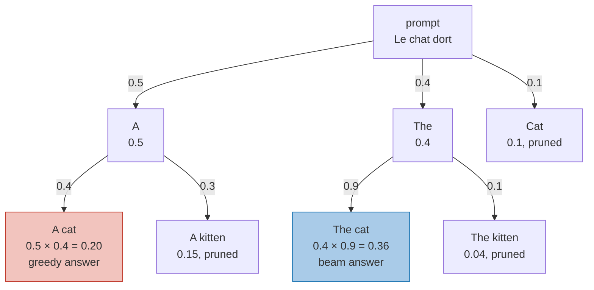

A chat assistant first reads your whole message and then writes its reply word by word, and those two halves of the job cost very different things. **Inference** is running a trained model to produce output, as opposed to training it. A **token** is one unit of text the model reads or writes, usually a word or a piece of a word. A **large language model**, or LLM, is a network trained to predict the next token from the tokens before it, so writing a reply means predicting one token, appending it, and predicting again.

Two questions decide everything in this note. The first is how fast the hardware can produce each next token, which is mostly a question of how many bytes have to be moved from memory per token. The second is which token to pick once the model has scored all of them, which is a question about a probability distribution and has nothing to do with hardware. The figure shows the first question for the reference 7B model reading a 1,000-token prompt.

The blue block is arithmetic on 1,000 tokens at once and the red blocks are one token each, yet a red block costs about an eighth of the blue one. That ratio explains most serving decisions: anything that lets one memory read serve more tokens, such as batching, quantization or speculative decoding, makes generation cheaper.

---

## 1. Prefill and decode phases

Reading a paragraph you are about to answer takes one glance, while writing the answer takes one word at a time because each word depends on the last. A model works the same way. **Prefill** is the first phase, in which the model processes every prompt token in one parallel pass and produces the probabilities for the first output token. **Decode** is the second phase, in which the model produces one token per step, appends it, and runs again on just that new token. Decode cannot be parallelized across output positions, because token 5 of the answer is unknown until token 4 has been chosen.

Each phase has its own latency number. **Time to first token**, or TTFT, is the wait from sending a request to seeing the first output token, so it covers queueing plus prefill. **Time per output token**, or TPOT, is the average gap between later tokens, so it is the decode step time. A reply of $m$ tokens therefore takes about TTFT plus $(m-1)$ times TPOT, where $m$ is the reply length.

Prefill cost follows from a rule worked out in [The Transformer Block and Model Anatomy](/tutorials/llm-fundamentals/the-transformer-block-and-model-anatomy/). A forward pass costs about $2N$ **floating point operations**, or FLOPs, per token, where a FLOP is one multiply or one add on a decimal number and $N$ is the parameter count. A 1,000-token prompt on the 7B model therefore costs $2 \times 6.74 \times 10^9 \times 1{,}000 = 1.35 \times 10^{13}$ FLOPs, or 13.5 trillion. Attention between the prompt tokens adds about $2n^2d$ per layer for $n = 1{,}000$ tokens of width $d = 4{,}096$, which over 32 layers is 0.26 trillion, about 2% more. At $F = 989 \times 10^{12}$ FLOPs per second and 40% utilization, the same assumption [Pretraining at Scale](/tutorials/llm-fundamentals/pretraining-at-scale/) uses for training, prefill takes 34 ms. One decode step at batch 1 takes about 4.0 ms, for reasons section 3 works out, so a 200-token answer takes about $34 + 199 \times 4.0 = 830$ ms. The two numbers respond to different things. TTFT grows with prompt length, roughly linearly until attention becomes large. TPOT barely depends on the prompt at batch 1, but it grows when many users share a GPU, as sections 2 and 3 show. **Max tokens**, a cap on how many tokens a request may generate, bounds the decode half of the bill: at 4.0 ms per token a cap of 256 tokens limits one request to about one second of decoding.

## 2. The key value cache

Rereading an entire book before writing each new sentence would make writing painfully slow, so people keep notes instead. A transformer's **attention** step, the operation in which each token looks back at earlier tokens and mixes in information from them (see [Attention and Positional Information](/tutorials/llm-fundamentals/attention-and-positional-information/)), needs two vectors from every earlier token: a **key**, which says what that token offers to be matched against, and a **value**, which is the information it hands over. These depend only on the earlier token and the layer, so they never change once computed. The **key value cache**, or KV cache, stores them for every layer and every earlier token so each decode step computes keys and values for the new token only. Without the cache, the 500th step would recompute keys and values for all 500 tokens so far. Generating 1,000 tokens would then process $1 + 2 + \cdots + 1{,}000 = 500{,}500$ token positions instead of 1,000, roughly 500 times the work.

The size of the cache is a product of the model's shape. Per token it stores a key and a value (the factor 2), in each of 32 layers, for 32 heads of width 128, at $s = 2$ bytes per number in [bf16](/tutorials/llm-fundamentals/pretraining-at-scale/#8-mixed-precision-with-bf16):

$$
2 \times 32 \times 32 \times 128 \times 2 = 524{,}288 \text{ bytes} = 0.5 \text{ MiB per token}.
$$

A MiB is $2^{20}$ bytes and a GiB is $2^{30}$ bytes, while GB means $10^9$ bytes. A full 4,096-token sequence therefore holds $4{,}096 \times 0.5$ MiB $= 2$ GiB, which is 2.15 GB.

### A memory budget for concurrent users

The graphics processing unit (GPU) has 80 GB of memory, and the weights take 13.48 GB of it, as computed in [The Transformer Block and Model Anatomy](/tutorials/llm-fundamentals/the-transformer-block-and-model-anatomy/). That leaves 66.5 GB. Dividing by 2.15 GB per full-length sequence gives 30.98, so 30 users at 4,096 tokens each fit at once. Real servers keep a margin for activations, the temporary numbers a forward pass produces, and for library workspace, and leaving 10% of the GPU free gives $(72 - 13.48)/2.15 = 27$ sequences. So the 7B model's cache, for one GPU's worth of users, is four to five times larger than the model itself.

The cache dominates because this model gives every query head its own keys and values. **Grouped query attention**, or GQA, lets several query heads share one key and value head, and Llama 3 8B uses 8 key value heads instead of 32, which shrinks the cache to 0.125 MiB per token and fits four times as many users. Efficient Attention Mechanisms works through that tradeoff in depth.

## 3. Memory bandwidth bound decoding

A cashier can scan items far faster than a delivery truck can restock the shelves, so the store's real speed is set by the truck. A graphics processing unit (GPU) has the same imbalance between arithmetic and memory. **Memory bandwidth** $\beta$ is how many bytes per second can move from the GPU's main memory, called high bandwidth memory or HBM, to its compute units, and on an H100 it is 3.35 TB/s. **Arithmetic intensity** is the number of FLOPs a computation performs per byte it moves. A computation is **memory bandwidth bound** when its intensity is too low to keep the compute units busy, so its speed is set by $\beta$, and compute bound when the reverse holds and its speed is set by peak compute $F$.

The dividing line is the **ridge point**, the intensity at which both limits take the same time, $F/\beta = 989 \times 10^{12} / 3.35 \times 10^{12} = 295$ FLOPs per byte. Decode at batch 1 reads every weight once to produce one token. Each weight is 2 bytes and contributes 2 FLOPs, a multiply and an add, so the intensity is 1 FLOP per byte, about 300 times below the ridge. The step time is then the time to read the weights, $13.48 \text{ GB} / 3.35 \text{ TB/s} = 4.0$ ms, so one sequence can get at most about 250 tokens per second. Prefill of 1,000 tokens reuses each weight read for 1,000 tokens, reaching 1,000 FLOPs per byte, so it sits above the ridge and is compute bound.

### Batching as the way to reuse each weight read

A **batch** is a group of sequences the GPU advances together in one step. Every sequence in the batch multiplies its own new token by the same weights, so one read of the weights now serves $b$ tokens and the intensity rises to about $b$ FLOPs per byte. **Throughput**, the total tokens per second across all users, therefore grows almost linearly with batch size while the weight read still dominates the step time.

Work the numbers with short contexts of 128 tokens, where the cache adds little. At $b = 1$ a step takes 4.04 ms and yields 247 tokens per second. At $b = 64$ the weights still take 4.02 ms to read, the 64 caches add 4.3 GB more at 1.3 ms, and the arithmetic takes only 0.87 ms, so a step takes 5.3 ms and yields 12,064 tokens per second, 49 times more for 64 times the users. Each user sees 188 tokens per second instead of 247, which is the price of sharing.

Long contexts change this because every sequence's cache must also be read every step, and that read does not get shared. With 2,048 tokens of context each sequence adds 1 GiB of cache reads per step. At $b = 32$ the step reads $13.48 + 34.4 = 47.8$ GB and takes 14.3 ms, giving 2,241 tokens per second, only 9 times the batch-1 rate. Memory fills at 61 such sequences, long before the weights alone would turn compute bound near a batch of 295.

The figure is a model with two limits, so it overstates real speed, since actual kernels reach well under peak compute and under peak bandwidth. Its shape still holds in practice: batching is close to free while weights dominate the bytes moved, and cache reads cap the gain once contexts are long.

## 4. Greedy and beam search

Once the model has scored every token, something has to pick one, and the rule for picking is called the **decoding strategy**. The model's raw scores are **logits** $z_i$, one per token in the vocabulary, and the **softmax** turns them into probabilities by exponentiating each and dividing by the sum, $p_i = e^{z_i}/\sum_j e^{z_j}$, so they are positive and add to 1. [Language Modeling and Next Token Prediction](/tutorials/llm-fundamentals/language-modeling-and-next-token-prediction/) derives where these scores come from.

**Greedy decoding** always picks the single most likely token. It is fast and deterministic, meaning the same prompt always gives the same output, but it can walk into a dead end because a strong first word may only allow weak continuations. **Beam search** keeps the $W$ best partial outputs at each step, where the beam width $W$ is a small number such as 4, scores each by the product of its token probabilities, extends all of them by one token, and again keeps the best $W$.

Take a translation of the French "Le chat dort" with the toy probabilities in the tree. Greedy picks "A" at 0.5 over "The" at 0.4, then "cat" at 0.4, for a sequence probability of $0.5 \times 0.4 = 0.20$. Beam search with $W = 2$ keeps both "A" and "The", and after one more step "The cat" scores $0.4 \times 0.9 = 0.36$, so it wins by looking one step further.

Multiplying probabilities always shrinks the score, so beam search favors short outputs, and implementations divide the log probability by a power of the length, which is called length normalization. Beam search helps when one correct output exists, as in translation or speech recognition. It hurts open-ended writing, because the highest probability text tends to be bland and repetitive, a failure documented in [The Curious Case of Neural Text Degeneration](https://arxiv.org/abs/1904.09751). It also costs $W$ times the cache and compute, so a beam of 4 on the 7B holds 8 GiB of cache for one 4,096-token request.

## 5. Temperature sampling

Rolling a die weighted by the model's probabilities gives varied text, and adjusting how lopsided that die is controls how adventurous the text gets. **Sampling** means drawing the next token at random in proportion to its probability rather than always taking the top one. **Temperature** $T$ adjusts the lopsidedness by dividing every logit by $T$ before the [softmax](/tutorials/llm-fundamentals/language-modeling-and-next-token-prediction/#5-logits-and-softmax):

$$
p_i = \frac{e^{z_i/T}}{\sum_j e^{z_j/T}}.
$$

Here $z_i$ is the logit of token $i$, $T$ is a positive number, and the sum runs over every token in the vocabulary. Dividing by $T$ below 1 stretches the gaps between logits, so the leader gains. Dividing by $T$ above 1 squeezes them, so the tail gains. The order of tokens never changes, since dividing by a positive number keeps every comparison the same.

Take the prompt "My coffee is too" with six candidates whose logits are hot 3.0, strong 2.5, sweet 2.0, bitter 1.5, cold 1.0 and loud 0.0. At $T = 1$ the exponentials are 20.09, 12.18, 7.39, 4.48, 2.72 and 1.00, which sum to 47.86, so hot gets $20.09/47.86 = 0.420$ and the full list is 0.420, 0.255, 0.154, 0.094, 0.057 and 0.021. At $T = 0.5$ every logit doubles, the sum becomes 634.9, and hot rises to 0.635 while loud falls to 0.002. At $T = 2$ every logit halves, the sum becomes 15.46, and hot falls to 0.290 while loud rises to 0.065, three times its $T = 1$ share.

<video class="cm-figure-video" src="/images/llm-fundamentals/15g-temperature-reshaping.mp4" autoplay loop muted playsinline controls preload="metadata" aria-label="Temperature reshaping"></video>

As $T$ approaches 0, the largest logit takes all the probability, so sampling becomes greedy decoding. Most serving interfaces (APIs) treat $T = 0$ as an instruction to return the most likely token rather than divide by zero. Temperature 0 is still not perfectly reproducible on GPUs, because two logits that tie to many decimal places can swap order when batch composition changes the order of floating point additions.

## 6. Truncation with top k top p and min p

Even a sensible distribution has a long tail of tokens the model rates as nearly impossible, and across a vocabulary of 32,000 tokens those tiny probabilities add up. If 30,000 junk tokens each hold 0.00001, together they hold 0.3, so almost one draw in three lands on junk. **Truncation** removes the unlikely tokens before drawing and then performs **renormalization**, dividing the survivors by their total so they add to 1 again.

**Top k sampling** keeps the $k$ most likely tokens, as used in [hierarchical story generation](https://arxiv.org/abs/1805.04833). **Top p sampling**, also called nucleus sampling from [the same degeneration paper](https://arxiv.org/abs/1904.09751), keeps the smallest set of top tokens whose probabilities add to at least $p_{\text{top}}$. **Min p sampling** keeps every token whose probability is at least $p_{\min}$ times the leading token's probability ([min p paper](https://arxiv.org/abs/2407.01082)).

Apply all three to the coffee distribution at $T = 1$. Top k with $k = 3$ keeps hot, strong and sweet, which hold 0.829, and renormalizes them to 0.506, 0.307 and 0.186. Top p with $p_{\text{top}} = 0.9$ walks down the running totals 0.420, 0.675, 0.829 and 0.922, so it stops at bitter and keeps four tokens. Min p with $p_{\min} = 0.1$ sets a bar at $0.1 \times 0.420 = 0.042$, which cold at 0.057 clears and loud at 0.021 does not, so it keeps five.

The rules differ in what they adapt to. Top k ignores the model's confidence, so $k = 3$ is too generous when one token is clearly right and too strict at the start of a sentence. Top p adapts by mass, but on a confident model it can admit junk: if the leader holds 0.80 and the remaining 0.20 is spread at 0.001 per token, reaching 0.95 requires about 150 junk tokens. Min p at 0.05 sets the bar at 0.04 in that case and admits none, which is why it suits the sharply peaked distributions of instruction-tuned models. Most serving stacks apply penalties first, then temperature, then truncation, and reversing temperature and truncation changes which tokens survive. Decoding works through those orderings.

## 7. Repetition control stopping and grammar masks

A model that has just written "very very" often finds "very" even more likely next, and without intervention it can loop. Three penalties adjust the logit of a token that has already appeared $c_i$ times, before temperature is applied. The **repetition penalty** from [CTRL](https://arxiv.org/abs/1909.05858) divides a positive logit by a factor $\rho$ once a token has appeared at all. The **frequency penalty** subtracts $\lambda_{\text{freq}} c_i$, so it grows with every repeat. The **presence penalty** subtracts $\lambda_{\text{pres}}$ once, however often the token appeared.

Suppose "hot" at logit 3.0 has already appeared twice in the coffee example. With $\rho = 1.2$ its logit becomes $3.0/1.2 = 2.5$, tying strong, and its probability falls from 0.420 to 0.305. A frequency penalty of 0.5 subtracts $0.5 \times 2 = 1.0$, leaving 2.0, so hot drops to 0.210 and strong leads at 0.346. A presence penalty of 0.5 subtracts 0.5 once, giving 2.5 and 0.305 again, but unlike the frequency penalty it would stay there after a tenth repeat. All three are blind to whether the repeat was correct, so they damage code, where a variable name must recur, and structured formats, where the same brackets and keys repeat by design.

Generation also needs a reason to stop. The model can emit an end of sequence token, a special token marking that the text is complete. A **stop sequence** is a string, such as the start of a new user turn, that ends generation when it appears in the decoded text, and it is matched on text rather than tokens because one string can be split into tokens in several ways. Max tokens from section 1 is the backstop, and a reply cut off by it is incomplete, so a well-built client checks which of the three ended the request.

**Constrained decoding** forces output to follow a grammar, a formal rule set that says which strings are valid, such as a schema listing the fields a JavaScript Object Notation (JSON) object must have. Before sampling each token, the server computes which tokens could still lead to a valid string and sets every other logit to minus infinity, a step called a **logit mask**, so those tokens get probability 0. Say the schema requires `{"rating": <integer>}` and the text so far is `{"rating": `. The model's top four candidates are "five" at 0.40, "5" at 0.30, a quote mark at 0.20 and "4" at 0.10, and only the two digits are legal, so after masking and renormalizing "5" gets 0.75 and "4" gets 0.25. [Outlines](https://arxiv.org/abs/2307.09702) precomputes the allowed tokens for each grammar state so the mask costs little per step. The output always parses, but here the model put most of its mass on an illegal answer, so a schema that fights the model's habits can lower quality, and putting the schema in the prompt as well usually helps.

## 8. Continuous batching and paged attention

A restaurant that seats a whole table at once and clears it only when the slowest diner finishes wastes most of its chairs. Static batching runs a group of requests together until the longest one is finished. Suppose four requests generate 20, 50, 100 and 400 tokens. All four slots stay occupied for 400 steps, so only $570/1{,}600 = 36\%$ of the slot steps produce a token. **Continuous batching**, introduced by the Orca serving system, rebuilds the batch at every decode step, so a finished request leaves immediately and a waiting request takes its slot at the next step.

That creates a memory problem, because requests now start and stop at random times and their caches grow by unpredictable amounts. Reserving each request's maximum length up front wastes the unused part. A request with a 1,000-token prompt allowed 2,000 more tokens reserves 3,000 slots, 1.5 GiB on the 7B, and if it stops at 1,100 tokens it wasted 950 MiB. Freed reservations of different sizes also leave gaps that no new request fits into, which is called **fragmentation**.

**PagedAttention**, introduced with the vLLM server in [Efficient Memory Management for LLM Serving](https://arxiv.org/abs/2309.06180), stores the cache in fixed-size blocks of $B$ tokens, usually $B = 16$, placed anywhere in memory. Each request keeps a **block table**, a short list that maps its first, second and third blocks to physical block numbers, and the attention kernel follows that list. A request claims a new block only when its last one is full, so its waste is at most $B - 1$ slots. The 1,100-token request above needs $\lceil 1{,}100/16 \rceil = 69$ blocks, where $\lceil \cdot \rceil$ means rounding up, holding 1,104 slots, so it wastes 4 slots, or 2 MiB. One 16-token block of the 7B cache is 8 MiB.

<video class="cm-figure-video" src="/images/llm-fundamentals/15g-paged-block-table.mp4" autoplay loop muted playsinline controls preload="metadata" aria-label="Paged block table"></video>

The animation uses blocks of 4 tokens so each slot is visible. Request B's blocks return to the free list the step it finishes, and request C reuses them at once even though they sit far apart. Blocks also make sharing cheap, since two requests with the same system prompt can point their tables at the same physical blocks, which Inference and Serving covers as prefix caching.

## 9. Weight and cache quantization

Rounding prices to the nearest dollar makes a receipt shorter and only slightly wrong. **Quantization** stores numbers with fewer bits, such as int8 (8-bit integers, one byte) or int4 (4-bit integers, half a byte), plus a small scale per group of numbers that converts the integers back to approximate decimals. Because decode at small batch is memory bandwidth bound, fewer bytes per weight make it faster almost in proportion.

The 7B weights take 13.48 GB in bf16, 6.74 GB in int8 and 3.37 GB in int4, plus about 3% for scales at one 16-bit scale per 128 weights. The 4.0 ms floor per token from section 3 falls to about 2.0 ms and 1.0 ms, raising the batch-1 ceiling from 250 to roughly 500 and 1,000 tokens per second, before the extra work of converting back to decimals. The freed memory also holds more cache: int4 weights leave 76.6 GB, room for 35 full-length sequences instead of 30.

Take a group of four weights, 0.12, −0.40, 0.05 and 0.31, quantized to int4 with integer levels −7 to 7. The scale is the largest magnitude divided by 7, $0.40/7 = 0.0571$, so the stored integers are 2, −7, 1 and 5, which convert back to 0.114, −0.400, 0.057 and 0.286, an error of at most 0.024. Now replace 0.31 with an **outlier**, one weight far larger than the rest, of 4.0. The scale becomes $4.0/7 = 0.571$, and 0.12 and 0.05 both round to 0, so those weights vanish. Outliers are why naive rounding fails, and methods such as [GPTQ](https://arxiv.org/abs/2210.17323), which adjusts the remaining weights to compensate for each rounding error, and [AWQ](https://arxiv.org/abs/2306.00978), which protects the weights that multiply large activations, keep int4 quality close to bf16 on many tasks.

**KV cache quantization** applies the same idea to the cache. Storing keys and values in 8-bit floating point halves the cache to 1 GiB per 4,096-token sequence, so the bf16 7B fits 61 full-length users instead of 30, and also halves the cache reads that limited long-context batching in section 3. The risks concentrate where small errors compound: long chains of arithmetic, code, rare languages and very long contexts usually degrade before short chat does. Perplexity, the model's average uncertainty on held-out text (see [Language Modeling and Next Token Prediction](/tutorials/llm-fundamentals/language-modeling-and-next-token-prediction/)), often moves by under 1% and hides those losses, so quantized models should be checked on the actual target tasks.

## 10. Speculative decoding

A senior editor can check a junior writer's four sentences in about the time it takes to write one, so letting the junior draft and the senior verify speeds things up without lowering the bar. **Speculative decoding**, from [Leviathan et al.](https://arxiv.org/abs/2211.17192) and [Chen et al.](https://arxiv.org/abs/2302.01318), applies this to decode. A small **draft model** proposes $\gamma$ tokens one at a time, then the large **target model**, the one whose output we actually want, scores all $\gamma$ positions in one forward pass. That pass costs about the same 4.0 ms as producing one token, because section 3 showed the time goes to reading the weights, and four extra tokens barely raise the arithmetic.

Each drafted token $x$ is accepted with probability $\min(1, p(x)/q(x))$, where $q(x)$ is the draft model's probability for it and $p(x)$ is the target's. In practice a uniform draw $u$ between 0 and 1 is compared with that ratio. At the first rejection the target draws a replacement from the leftover distribution $\max(0, p(x) - q(x))$, rescaled to sum to 1, and every later draft is discarded. If all $\gamma$ drafts pass, the target's pass already holds the distribution for the next position, so one bonus token comes free.

### Why the output distribution is unchanged

This accept and resample rule is a form of **rejection sampling**, drawing from one distribution by proposing from another and rejecting some proposals. Check it on one position with three tokens. The target gives hot 0.5, strong 0.3 and sweet 0.2, and the draft gives 0.7, 0.2 and 0.1. Hot is drafted with probability 0.7 and accepted with probability $0.5/0.7 = 0.714$, so it is emitted with probability $0.7 \times 0.714 = 0.5$. Strong and sweet are always accepted when drafted, since the target likes them more. A rejection happens with total probability $0.7 \times 0.286 = 0.2$, and the leftover distribution is $(0, 0.1, 0.1)$, which rescales to strong 0.5 and sweet 0.5. So strong appears with probability $0.2 + 0.2 \times 0.5 = 0.3$ and sweet with $0.1 + 0.2 \times 0.5 = 0.2$, exactly the target's numbers. The speedup changes how fast tokens arrive, never which tokens arrive.

<video class="cm-figure-video" src="/images/llm-fundamentals/15g-speculative-accept-reject.mp4" autoplay loop muted playsinline controls preload="metadata" aria-label="Speculative accept reject"></video>

### Expected tokens per round

The **acceptance rate** $\alpha$ is the chance one drafted token survives, and token $j$ of a round appears only if the $j - 1$ drafts before it all passed. With $\alpha = 0.8$ and $\gamma = 4$ the round emits on average

$$
1 + \alpha + \alpha^2 + \alpha^3 + \alpha^4 = \frac{1 - \alpha^{\gamma + 1}}{1 - \alpha} = \frac{1 - 0.8^5}{1 - 0.8} = 3.36 \text{ tokens}.
$$

The geometric sum on the left adds the chances that tokens 1 through 5 are emitted, and the fraction is its closed form. If the draft is 10 times cheaper than the target, a round costs $4.0 + 4 \times 0.4 = 5.6$ ms for 3.36 tokens, or 1.7 ms per token against 4.0 ms, a 2.4 times speedup. The gain shrinks at large batch sizes, where the target pass is no longer nearly free, and with a poorly matched draft, since $\alpha = 0.5$ gives only 1.94 tokens per round.

## 11. Serving plan and latency diagnosis

Latency complaints usually arrive as "it feels slow", and the first move is to split that into TTFT and TPOT, because they have different causes, and the table maps each symptom to what to measure and the usual fix.

| Symptom | Likely cause | What to measure | Usual fix |
|---|---|---|---|
| High time to first token on long prompts | Prefill compute grows with prompt length | TTFT against prompt length on an idle server | Prefix caching of shared system prompts, shorter prompts, tensor parallelism across GPUs |
| High time to first token only under load | Queueing, or new prefills waiting behind others | Queue time versus prefill time per request | More replicas, chunked prefill that splits long prompts into pieces between decode steps |
| Slow tokens at batch 1 | Weight reads per step | TPOT against the 4.0 ms floor | int8 or int4 weights, speculative decoding |
| Slow tokens only at high load | Cache reads grow with batch and context | TPOT against batch size and average context | Cap batch size, quantize the cache, choose a grouped query attention model |
| Requests rejected or preempted | Cache memory full | Cache blocks in use and preemption count | PagedAttention, lower max tokens, more GPUs |
| Looping or rambling output | Decoding settings | Repeat rate and stop reasons per request | Mild presence penalty, stop sequences, min p |

For decoding settings, a reasonable starting point is temperature 0 for extraction and code, temperature 0.7 with top p 0.95 or min p 0.05 for chat, and a grammar mask whenever the output must parse. Change one setting at a time and judge it on held-out prompts from the real workload.

---

**Related**: [Language Modeling and Next Token Prediction](/tutorials/llm-fundamentals/language-modeling-and-next-token-prediction/) · [Attention and Positional Information](/tutorials/llm-fundamentals/attention-and-positional-information/) · [The Transformer Block and Model Anatomy](/tutorials/llm-fundamentals/the-transformer-block-and-model-anatomy/)
