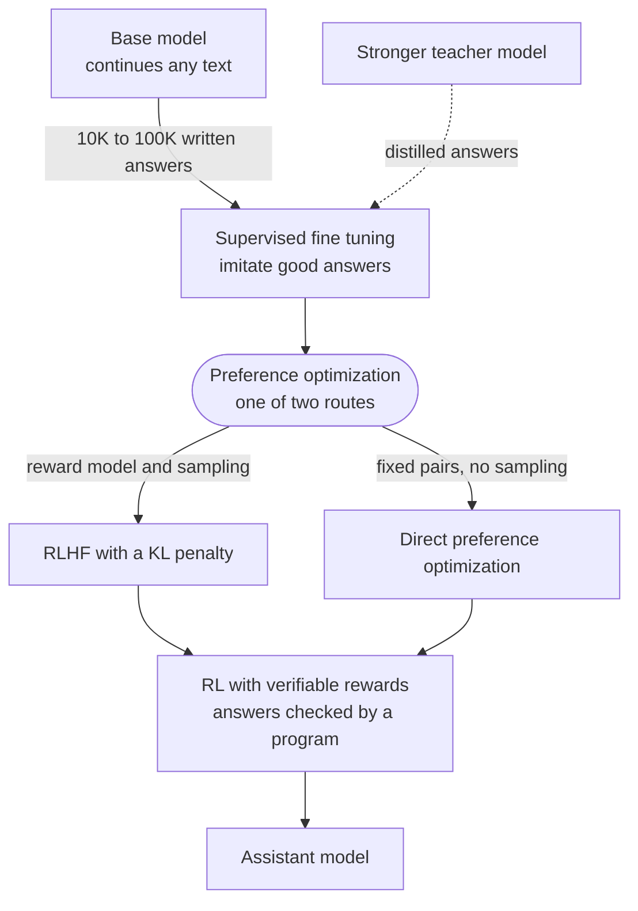

A model trained only to continue text can finish almost any document, but it does not yet behave like an assistant, and a question typed into it is often followed by more questions, the way quiz pages list them. A **base model** is the network that comes out of **pretraining**, the long first phase in which a model learns to predict the next **token**, a word piece of text, over trillions of tokens of ordinary writing. It does one thing, which is continue whatever text it is given. **Post training** is everything done to that network afterwards to turn it into an assistant, a model that answers the request in front of it, stops when it is finished, declines harmful requests and says when it does not know.

Every stage of post training makes the same kind of change, raising the probability of some outputs and lowering others, and the stages differ in who decides which outputs are good. Supervised fine tuning (SFT) shows the model one written answer per question. Preference methods, reinforcement learning from human feedback (RLHF) and direct preference optimization (DPO), show it which of two answers people liked better. Reinforcement learning with verifiable rewards lets a program grade answers the model writes itself. Going down that list, each labelled example gets cheaper and the model gets more freedom to find answers nobody wrote down, and the room it has to exploit a flawed grader grows with that freedom.

The stages differ most in where their training text comes from. SFT trains on text people wrote, DPO on comparisons collected before training began, and the reinforcement learning stages on text the model is writing at that moment. Only text the model writes during training can contain an answer nobody put in a dataset, and only that text can drift into whatever odd outputs the grader happens to overrate, which is why the KL penalty and reward hacking appear in the last stages and not in the first.

---

## 1. Base model behavior

Ask a base model "What is the capital of France?" and you may get back "What is the capital of Germany? What is the capital of Italy?". The model knows the answer, but the most common thing to follow a quiz question on the web is another quiz question. A **probability distribution** over tokens is a list giving each possible next token a chance, with all chances adding to 1, and [greedy decoding](/tutorials/llm-fundamentals/inference-and-decoding/#4-greedy-and-beam-search) picks the token with the largest chance at every step.

Take illustrative numbers for the token after the question mark and a line break. "What", which starts a new question, gets 0.40, "The" gets 0.15, "Paris" gets 0.10, and every other token shares the remaining 0.35. Greedy decoding writes "What" and the model is off listing questions. Give the same model the prompt "Q: What is the capital of France? A:" and "Paris" might get 0.60, because pages in that format put an answer after "A:". The fact is in the weights, and the default behavior is to continue the document in its most typical way.

Post training therefore has to add behavior rather than knowledge. The model must treat the input as a request from someone, answer it in a consistent format, emit a token that means it is done, and prefer helpful, honest and harmless answers among the many continuations it already finds plausible. [InstructGPT](https://arxiv.org/abs/2203.02155) made the scale of this visible: labellers preferred answers from a 1.3 billion parameter model after post training over answers from the 175 billion parameter GPT-3 base model, a model about 130 times larger. Section 2 covers the first and simplest way to add that behavior.

## 2. Supervised fine tuning

The plainest way to teach a new behavior is to show examples of it, the way a new support agent reads a binder of good replies before answering customers. **Supervised fine tuning**, or SFT, continues training the base model on **instruction response pairs**, each a prompt together with an answer a person wrote or approved. The **loss**, the number training pushes down by **gradient descent** (repeatedly nudging every weight in the direction that lowers it), is the same next token **cross entropy** used in pretraining, meaning minus the log probability the model gave to each token the written answer actually contains, as [Language Modeling and Next Token Prediction](/tutorials/llm-fundamentals/language-modeling-and-next-token-prediction/) develops.

$$
\mathcal{L}_{\text{SFT}}=-\sum_{t=1}^{|y|}\log \pi_\theta(y_t\mid x,y_{<t})
$$

Here $x$ is the prompt, $y$ the written response with $|y|$ tokens, $y_t$ its token at position $t$, $y_{<t}$ the response tokens before it, and $\pi_\theta$ the model with weights $\theta$. If the model gives "Paris" a probability of 0.10, that token costs $-\ln 0.10=2.30$ nats, the unit of a natural logarithm. After a few hundred steps on question and answer pairs it might give "Paris" 0.60, which costs $-\ln 0.60=0.51$ nats, and the continuation that lists more questions loses the probability that "Paris" gained.

Quality matters far more than quantity at this stage. [LIMA](https://arxiv.org/abs/2305.11206) fine tuned a 65 billion parameter model on 1,000 carefully chosen examples and got answers people often rated close to much larger post training runs, which led its authors to the **superficial alignment hypothesis**, the claim that SFT mostly teaches format and style for knowledge the base model already has. A model copies the typical answer in its data, so 10,000 clean answers usually beat 500,000 scraped ones that include sloppy or wrong ones. The compute is small at 7B scale. Ten thousand examples of 500 tokens is 5 million tokens, and at a training cost of about 40.4 GFLOPs (billions of floating point operations) per token for the reference 7B model that is $2.0\times10^{17}$ FLOPs, roughly 510 seconds of one H100 graphics processor (GPU) at 40% utilization, against $8.09\times10^{22}$ for pretraining. Memory is what bites, since full fine tuning holds about 108 GB of weights, gradients and [optimizer state](/tutorials/llm-fundamentals/pretraining-at-scale/#6-optimizer-memory), more than one 80 GB GPU, which is why low rank adapters ([Using LLMs in Applications](/tutorials/llm-fundamentals/using-llms-in-applications/)) are common here.

SFT has two important limits. It can only imitate, so it never sees a bad answer and never learns how much better one answer is than another. And it cannot add knowledge reliably: [fine tuning on facts the base model did not know](https://arxiv.org/abs/2405.05904) was learned slowly and increased **hallucination**, fluent statements that are false, because the model learns to answer confidently past what it knows. Training too long on narrow data also causes **catastrophic forgetting**, the loss of abilities the narrow data never exercised.

## 3. Prompt loss masking

When a tutor grades your homework, they grade your answers and not the questions printed on the worksheet. **Prompt loss masking** applies the same rule to supervised fine tuning (SFT): the whole chat is fed to the model so that every response token can see the question, but only the response tokens contribute to the loss. Without it, part of every gradient teaches the model to write user questions, which it will never be asked to do.

The chat is first laid out with a **chat template**, a fixed format that wraps each turn in special tokens, reserved tokens such as `<user>`, `<assistant>` and `<end>` that mark who is speaking and where a turn ends ([Tokenization and Embeddings](/tutorials/llm-fundamentals/tokenization-and-embeddings/) covers how they enter the vocabulary). The masked loss over the whole sequence is

$$
\mathcal{L}_{\text{mask}}=-\frac{\sum_{t=2}^{T} m_t\log\pi_\theta(s_t\mid s_{<t})}{\sum_{t=2}^{T} m_t}
$$

where $s_t$ is token $t$ of the formatted chat, $s_{<t}$ the tokens before it, $T$ the chat length, and $m_t$ the loss mask, 1 for a token the model should learn to write and 0 otherwise. The sum starts at 2 because the first token has nothing before it to predict from. Dividing by the sum of the mask averages over trained tokens only.

Work the eight token chat `<user>` What is 2+3 ? `<assistant>` 5 `<end>` with illustrative probabilities. The model predicts "What" with 0.05, "is" with 0.40, "2+3" with 0.02, "?" with 0.60, `<assistant>` with 0.90, "5" with 0.50 and `<end>` with 0.80. Their losses are 3.00, 0.92, 3.91, 0.51, 0.11, 0.69 and 0.22 nats. Unmasked, the average over all seven predictions is 9.36 divided by 7, or 1.34 nats, and 90% of that total comes from the prompt. Masked, only "5" and `<end>` count, so the loss is (0.69 + 0.22) / 2 = 0.46 nats, and every gradient step goes into answering and stopping.

The `<end>` token deserves the mask as much as the answer does, since a model never trained to emit it rambles until the length limit. In a conversation of many turns every assistant turn gets $m_t=1$ and every user turn gets 0. The template used at training must match the template used at serving, and a mismatch, such as a missing `<assistant>` marker, is one of the most common reasons a fine tuned model suddenly behaves like a base model again.

## 4. Preference data and reward models

Most people struggle to write a perfect cover letter but can easily say which of two letters is better. A **preference pair** captures that easier judgement: one prompt, two responses, and a label saying which one a person preferred. Labellers can produce comparisons quickly, and a comparison carries information a supervised fine tuning (SFT) example cannot, namely what to avoid. **AI feedback** replaces the person with a strong model following written rules, as in [Constitutional AI](https://arxiv.org/abs/2212.08073), which is much cheaper and inherits that judge's biases.

A **reward model** turns those labels into a score. It is usually a copy of the language model with its final layer replaced by one that outputs a single number $r(x,y)$ for prompt $x$ and response $y$. The **Bradley-Terry model**, a 1952 model of paired comparisons, links scores to labels by saying the preferred response wins with probability equal to the sigmoid of the score gap.

$$
P(y_w\succ y_l\mid x)=\sigma\big(r(x,y_w)-r(x,y_l)\big),\qquad \mathcal{L}_{\text{RM}}=-\log\sigma\big(r(x,y_w)-r(x,y_l)\big)
$$

Here $y_w$ is the response the labeller preferred, $y_l$ the one they rejected, $\succ$ reads "is preferred to", and $\sigma(z)=1/(1+e^{-z})$ is the **sigmoid**, which maps any number to a probability between 0 and 1. Suppose the reward model scores response A at 1.5 and response B at 0.5. The gap is 1.0, so it predicts A wins with probability $\sigma(1.0)=0.73$. If the labeller did prefer A, the loss is $-\ln 0.73=0.31$ nats. If they preferred B, the gap is $-1.0$ and the loss is $-\ln 0.27=1.31$ nats. The gradient on a pair is scaled by 1 minus the predicted probability, here 0.27 when the model already agrees, so training concentrates on pairs it gets wrong.

Only the gap enters the loss, so adding the same constant to every score changes nothing, and a reward of 3.2 means nothing until you know the spread of other scores. The gap scale, by contrast, has a reading. Humans often agree with each other only 70% to 80% of the time on open ended pairs (InstructGPT reported about 73% agreement between labellers), so a reward model that is 95% accurate on held out pairs has almost certainly learned a shortcut such as preferring longer answers, a failure section 10 returns to.

## 5. RLHF with a KL penalty

A student who studies only to please one examiner learns that examiner's quirks, so a sensible coach adds a rule: improve your score, but do not change your style so much that a different examiner would no longer recognize your work. Reinforcement learning from human feedback, or **RLHF** ([Christiano et al.](https://arxiv.org/abs/1706.03741), then InstructGPT), uses the reward model as the examiner and the supervised fine tuning (SFT) model as the style to stay near. The model being trained is called the **policy**, the frozen SFT copy is the **reference model**, and each training batch is a set of rollouts, responses the current policy writes and the reward model scores.

$$
\max_\theta\;\mathbb{E}_{x,\;y\sim\pi_\theta}\big[r(x,y)\big]-\beta\,D_{\text{KL}}\big(\pi_\theta(\cdot\mid x)\,\|\,\pi_{\text{ref}}(\cdot\mid x)\big)
$$

$\mathbb{E}$ averages over prompts $x$ from the dataset and responses $y$ sampled from the policy $\pi_\theta$, $r(x,y)$ is the reward model's score, $\pi_{\text{ref}}$ is the reference model, and $D_{\text{KL}}$ is the **KL divergence** ([Kullback-Leibler](/tutorials/llm-fundamentals/language-modeling-and-next-token-prediction/#9-maximum-likelihood-as-distribution-matching)), the average over the policy's own samples of $\log\pi_\theta(y\mid x)-\log\pi_{\text{ref}}(y\mid x)$, which is 0 when the two models agree. The **KL coefficient** $\beta$ sets how much reward one nat of drift has to buy. The penalty exists because the reward model was fitted on responses near the reference model, so its scores are trustworthy only there, and an optimizer without the penalty walks straight to responses the reward model overrates.

For one sampled response the penalty is usually estimated from the response's own tokens. Take a three token response whose per token log ratios $\log\pi_\theta-\log\pi_{\text{ref}}$ are 0.5, 0.2 and −0.1, summing to 0.6 nats, with reward 2.0 and $\beta=0.1$. Its penalized reward is $2.0-0.1\times0.6=1.94$. A second response scores higher at 2.6 but has drifted to a log ratio of 8.0 nats, so its penalized reward is $2.6-0.8=1.8$, and the objective prefers the first response even though the reward model liked the second more.

The objective has an exact best solution, $\pi^{\star}(y\mid x)=\pi_{\text{ref}}(y\mid x)\,e^{r(x,y)/\beta}/Z(x)$, where $\pi^{\star}$ is the best policy and $Z(x)$ is the sum of $\pi_{\text{ref}}\,e^{r/\beta}$ over every possible response, which makes the probabilities add to 1. With three possible responses at reference probabilities 0.5, 0.3 and 0.2 and rewards 0, 1 and 2, setting $\beta=1$ gives weights 0.5, 0.3e = 0.82 and 0.2e² = 1.48, which divide by their sum 2.79 to 0.18, 0.29 and 0.53. The expected reward rises from 0.70 to 1.35 at a KL of 0.32 nats, and halving $\beta$ to 0.5 pushes the best response to 0.80.

In practice nobody can sum over every possible response, so RLHF follows the gradient of the objective with **proximal policy optimization**, or PPO ([Schulman et al.](https://arxiv.org/abs/1707.06347)), which limits how far each update can move the policy and uses a **critic**, a second network that predicts the reward expected from each point in a response. Developed in Proximal Policy Optimization and RL for Language Models, it is expensive at 7B scale because four models are live at once, the policy, the reference, the reward model and the critic, which is about 54 GB of weights stored in [bf16](/tutorials/llm-fundamentals/pretraining-at-scale/#8-mixed-precision-with-bf16), a 2 byte number format, before the 108 GB of training state for each of the two trained networks.

## 6. Direct preference optimization

If the best policy for any reward is a fixed formula of that reward, the formula can be run backwards, so that a policy implies a reward. **Direct preference optimization**, or DPO ([Rafailov et al.](https://arxiv.org/abs/2305.18290)), uses that to skip the reward model and the sampling loop of section 5 entirely. Rearranging $\pi^{\star}=\pi_{\text{ref}}e^{r/\beta}/Z$ gives $r(x,y)=\beta\log\frac{\pi^{\star}(y\mid x)}{\pi_{\text{ref}}(y\mid x)}+\beta\log Z(x)$. Plug that into the Bradley-Terry gap of section 4 and the awkward $\beta\log Z(x)$ term appears once for the winner and once for the loser of the same prompt, so it cancels.

$$
\mathcal{L}_{\text{DPO}}=-\log\sigma\Big(\beta\Big[\log\frac{\pi_\theta(y_w\mid x)}{\pi_{\text{ref}}(y_w\mid x)}-\log\frac{\pi_\theta(y_l\mid x)}{\pi_{\text{ref}}(y_l\mid x)}\Big]\Big)
$$

$\pi_\theta$ is the policy being trained, $\pi_{\text{ref}}$ the frozen supervised fine tuning (SFT) model, $y_w$ and $y_l$ the preferred and rejected responses, $\beta$ the KL coefficient and $\sigma$ the sigmoid. Each log ratio says how much more likely the policy makes a response than the reference does, and $\beta$ times that log ratio is the **implicit reward**, the score the policy's own probabilities stand for. The whole loss is a logistic classification on fixed pairs, so it trains like SFT, one forward pass through two models per response and no text generation.

The loss needs only four numbers per pair. Say the policy gives the winner a log probability of −10.0 and the reference gives it −11.0, while the policy gives the loser −12.0 and the reference −11.5. The winner's log ratio is +1.0 and the loser's is −0.5, so the margin is 1.5 and $\beta=0.1$ turns it into 0.15. Then $\sigma(0.15)=0.537$ and the loss is $-\ln0.537=0.621$ nats, down from $\ln2=0.693$ at the start of training, when the policy equals the reference and both log ratios are 0. The gradient on this pair is scaled by $1-0.537=0.463$.

<video class="cm-figure-video" src="/images/llm-fundamentals/15f-dpo-one-pair.mp4" autoplay loop muted playsinline controls preload="metadata" aria-label="Dpo one pair"></video>

What DPO gives up is the ability to learn from its own mistakes. Its pairs were written before training, usually by another model, so it never sees and never corrects failures that its own current policy produces, and it can lower the probability of both responses as long as the loser falls faster, a known effect called likelihood displacement covered in Direct Preference Optimization and Its Variants. Proximal policy optimization (PPO) costs more but keeps scoring fresh samples. A common practical answer is iterative DPO, which regenerates pairs from the current policy every round.

## 7. Verifiable rewards and GRPO

A maths teacher marking a test does not need taste or opinion to grade "17 × 24 = 408", only the answer key. A **verifiable reward** is a score computed by a program instead of a learned model: 1 if the final answer matches the reference answer or the generated code passes its unit tests, 0 otherwise. Training a policy against such checks is reinforcement learning with verifiable rewards, or **RLVR**, a name from the [Tülu 3](https://arxiv.org/abs/2411.15124) report. The reward cannot drift the way a learned reward model can, though section 10 shows that a careless checker can still be gamed.

**Group relative policy optimization**, or GRPO ([DeepSeekMath](https://arxiv.org/abs/2402.03300)), is the usual algorithm for this. It drops the critic from section 5 and instead samples a group of $G$ responses to the same prompt, then scores each response against its own group. The **advantage**, how much better one response did than the policy's typical response to that prompt, is

$$
A_i=\frac{r_i-\bar r}{\mathrm{sd}(r_1,\dots,r_G)}
$$

where $r_i$ is the reward of response $i$, $\bar r$ is the mean reward over the group, and $\mathrm{sd}$ is the standard deviation of the group's rewards, the typical distance of a reward from that mean. A positive advantage raises the probability of every token in that response and a negative one lowers it, with the same clipped update and KL penalty as proximal policy optimization (PPO) in section 5.

Work one group of $G=4$ for the prompt "What is 17 × 24?". The policy answers 408, 418, 398 and 308, and the checker gives rewards 1, 0, 0 and 0. The mean is 0.25 and the standard deviation is $\sqrt{0.25\times0.75}=0.433$. The correct answer gets $(1-0.25)/0.433=+1.73$ and each wrong answer gets $(0-0.25)/0.433=-0.58$, so the advantages sum to zero and the rare success gets the large push. If all four answers had been right, every reward would equal the mean, every advantage would be 0, and the prompt would teach nothing, which is why RLVR pipelines filter for prompts the model solves sometimes but not always.

<video class="cm-figure-video" src="/images/llm-fundamentals/15f-grpo-group-advantages.mp4" autoplay loop muted playsinline controls preload="metadata" aria-label="Grpo group advantages"></video>

GRPO saves the critic's memory, about 13 GB of weights plus its training state at 7B, and pays in generation, since every prompt now needs $G$ rollouts, often 8 to 64 of them and each up to thousands of tokens long. Verifiable rewards fit maths, code, structured extraction and anything else with a checkable answer. Open ended writing has no answer key, so helpfulness and tone still come from preference methods. Group Relative Policy Optimization covers length normalization and the remaining details.

## 8. Reasoning models and test time compute

A person solving a hard puzzle writes scratch work before the answer, and gets more puzzles right when given more time. A **chain of thought** is the same scratch work produced as text before the final answer. A **reasoning model** is a model trained with reinforcement learning with verifiable rewards (RLVR, section 7) to produce long chains of thought because longer scratch work that checks itself earned more reward. [DeepSeek-R1](https://arxiv.org/abs/2501.12948) showed that group relative policy optimization (GRPO) on a base model with only answer checks raised its pass rate on the 2024 American Invitational Mathematics Examination (AIME) from 15.6% to 71.0%, with chains growing to thousands of tokens and the model learning on its own to backtrack and recheck.

**Test time compute** is extra computation spent while answering rather than while training. One form is a longer [chain of thought](/tutorials/llm-fundamentals/using-llms-in-applications/#3-chain-of-thought-and-self-consistency), and accuracy on hard problems usually rises with the number of thinking tokens ([Snell et al.](https://arxiv.org/abs/2408.03314)). Another is sampling several answers. **Self-consistency** ([Wang et al.](https://arxiv.org/abs/2203.11171)) samples $k$ chains and returns the majority vote, the final answer that appears most often. If each sample is right with probability $p=0.6$, samples are independent, and wrong samples agree with each other, three votes are right when at least two samples are, which is $0.6^3+3\times0.6^2\times0.4=0.216+0.432=0.648$. Five votes give 0.683. With $p=0.4$ the same arithmetic makes voting worse, falling to 0.352 at three samples, because the majority is then usually wrong.

The independence assumption is optimistic, since samples from one model share its blind spots, and real voting gains flatten sooner than the curve. A **verifier**, a checker that can recognize a right answer, does much better than voting when one exists, because it only needs one right sample among $k$. The bill arrives at serving time ([Inference and Decoding](/tutorials/llm-fundamentals/inference-and-decoding/)). The reference 7B model decodes one sequence at about 4.0 ms per token, so a 200 token answer takes 0.8 seconds while 2,000 tokens of thinking take 8 seconds, and those 2,000 tokens hold 1,000 MiB of key and value cache, the stored attention keys and values of every earlier token at 0.5 MiB per token. Five votes multiply the tokens and the cache by five. Advanced Topics goes further into process supervision and how reasoning models are trained.

## 9. Distillation from stronger models

An apprentice learns faster from a master who explains which options were close calls than from one who only shows the final choice. **Distillation** trains a smaller student model to imitate a larger teacher model. **Sequence level distillation** generates whole answers with the teacher and uses them as supervised fine tuning data, which is how DeepSeek released 1.5B to 70B models that copy R1's reasoning chains. **Token level distillation** ([Hinton et al.](https://arxiv.org/abs/1503.02531)) instead trains on the teacher's whole next token distribution, called **soft labels**, rather than the single token it picked.

$$
\mathcal{L}_{\text{KD}}=-\sum_v q(v)\log\pi_\theta(v\mid \text{context})
$$

$q(v)$ is the teacher's probability for vocabulary token $v$, $\pi_\theta(v\mid\text{context})$ is the student's, and the sum runs over the vocabulary. When $q$ puts all of its probability on one token, this reduces to the supervised fine tuning [cross entropy](/tutorials/llm-fundamentals/language-modeling-and-next-token-prediction/#6-cross-entropy-loss) of section 2.

Take a three token vocabulary after "The capital of France is" with the teacher at Paris 0.7, Lyon 0.2, Rome 0.1 and the student at 0.5, 0.3, 0.2. A hard label on Paris costs $-\ln0.5=0.693$ nats. The soft label loss is $0.7\times0.693+0.2\times1.204+0.1\times1.609=0.887$ nats, of which 0.802 is the teacher's own uncertainty, which no student can remove, and the remaining 0.085 is the Kullback-Leibler (KL) divergence between teacher and student. The gradient with respect to the student's raw scores is student minus teacher, $(-0.2,+0.1,+0.1)$, against $(-0.5,+0.3,+0.2)$ for the hard label. The soft label asks for a smaller correction and tells the student that Lyon was a closer call than Rome.

Distillation is often the cheapest route to a strong small model, since the teacher's answers replace both human writing and reinforcement learning rollouts. Its ceiling is the teacher, and it copies the teacher's errors and refusal style along with its skill. Token level distillation needs the teacher's probabilities, which models sold only through an application programming interface (API) usually do not expose, and it needs the two models to share a tokenizer.

## 10. Reward hacking and sycophancy

When a call centre pays staff by calls closed per hour, some staff start hanging up on hard callers. Goodhart's law says a measure that becomes a target stops being a good measure, and **reward hacking** is that law inside post training: the policy finds outputs that score highly on the **proxy reward** it is optimized against while the true reward, what careful people would actually judge, stops improving or falls. [Gao et al.](https://arxiv.org/abs/2210.10760) measured this as **reward overoptimization** and found that true reward follows $d(a-b\ln d)$, where $d$ is the square root of the Kullback-Leibler (KL) divergence from the reference model and $a,b$ are fitted constants, so it rises, peaks and declines while the proxy keeps climbing.

**Length bias** is the most common hack in practice ([Singhal et al.](https://arxiv.org/abs/2310.03716)). Suppose a reward model adds about 0.01 to the score per token because labellers tended to prefer thorough answers. A 400 token answer then beats an equally good 200 token answer by a gap of 2.0, which by Bradley-Terry is a predicted preference of $\sigma(2.0)=0.88$, so the policy learns padding. **Sycophancy**, agreeing with the user, flattering them, or abandoning a correct answer when the user pushes back, follows the same route ([Sharma et al.](https://arxiv.org/abs/2310.13548)), because labellers rate agreement more highly. Verifiable rewards are hacked too when the checker is loose, for example a code policy that edits or deletes the unit tests, or a maths policy that prints several answers when the checker accepts any match.

Defenses attack the gap between proxy and truth. The KL penalty of section 5 keeps the policy where the reward model was trained. An **ensemble of reward models** ([Coste et al.](https://arxiv.org/abs/2310.02743)) scores with the minimum or a penalized mean across several models, since a hack that fools one model rarely fools all of them. Length controlled evaluation compares answers of matched length or regresses length out of the win rate. A held out gold evaluation, fresh human ratings or a stronger judge the policy never trained against, is watched alongside the proxy, and training stops when the proxy rises while the gold score flattens. For sycophancy, targeted tests ask the same question with and without the user stating a wrong opinion and count how often the answer flips.

## 11. Post training recipe selection

Choosing a recipe starts from what signal you can produce cheaply and what failure you are seeing, much as a coach picks drills from the mistakes a player keeps making. In the table, SFT is supervised fine tuning, DPO direct preference optimization, PPO proximal policy optimization and GRPO group relative policy optimization, and the table maps situations to the usual recipe, the data it needs, and the sign that the step did not work.

| Situation | Recipe | Data it needs | Sign that it failed |
|---|---|---|---|
| A base model must follow a format or domain style | SFT only, with prompt masking | 1K to 100K clean instruction response pairs | Ignores the template, never stops, or hallucinates more on new facts |
| Answers are correct but tone, safety or helpfulness lag | SFT then DPO | 10K to 100K preference pairs, ideally regenerated from the current model | Reward margin grows while win rate is flat, or answers get longer only |
| Quality depends on judgement, and you can afford online sampling | SFT, reward model, then PPO with a KL penalty | Preference pairs for the reward model plus a pool of prompts | Proxy reward climbs while held out human or judge ratings fall |
| Tasks have checkable answers such as maths, code or extraction | SFT then GRPO with verifiable rewards | Prompts with reference answers or tests, at a difficulty the model solves sometimes | Pass rate stalls with most groups all right or all wrong, or the checker is gamed |
| A strong teacher exists and serving must be cheap | Distillation into a smaller student | Teacher outputs or teacher probabilities on your prompts | Student matches the teacher on easy prompts and collapses on hard ones |

Run the stages in order and measure each against the checkpoint before it on the same frozen evaluation set, so a regression can be pinned to one stage and rolled back by reverting to the earlier checkpoint. Report capability benchmarks next to preference or pass rate gains, since a gain that costs a few points of general accuracy is the **alignment tax**, and decide in advance how large a tax you will accept before shipping.

