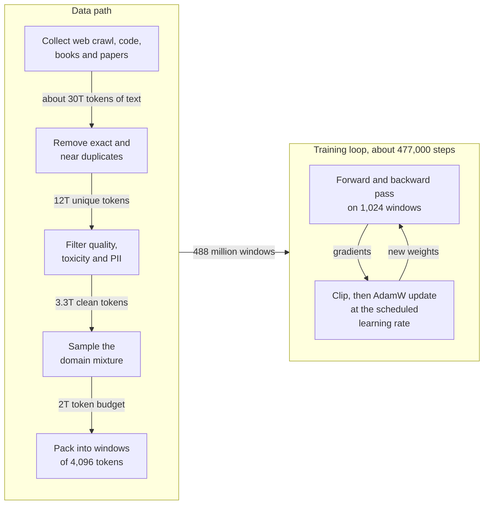

The first stage of building a chatbot teaches a model to guess the next word of text it has never seen, by having it read a large share of all available writing. A **language model** is a program that reads text and assigns a probability to every possible next piece of text, as [Language Modeling and Next Token Prediction](/tutorials/llm-fundamentals/language-modeling-and-next-token-prediction/) sets out. It runs on a neural network, a large function with adjustable numbers called **parameters** that training sets, and the reference model in this note has 6.74 billion of them. A **token** is the piece of text the model reads or predicts in one step, usually a word or part of a word ([Tokenization and Embeddings](/tutorials/llm-fundamentals/tokenization-and-embeddings/)). **Pretraining** is the stage in which the model reads trillions of tokens of ordinary text and nudges its parameters after every batch so that it predicts each next token a little better.

Pretraining is two engineering jobs that tend to get discussed as one. The data job decides which tokens the model sees and in what proportions. The optimization job decides how each batch moves the parameters without the run falling over. One budget of arithmetic ties them together, since total compute is about six times the parameter count times the token count, so every choice below is a choice about how to spend that product. The figure follows the running example, the 7B model trained on 2 trillion tokens, from raw crawl to the training loop. The stage sizes on the data side are illustrative assumptions in line with published pipelines.

The data path runs once and shrinks the text about fifteenfold, while the loop on the right repeats about 477,000 times. A defect in the data is therefore paid for on every step of the loop, and it usually surfaces late as a loss that stalls too high or jumps suddenly, which is why the data sections come before the optimizer.

---

## 1. The pretraining corpus

A public library is a fair picture of what the model reads, except that most of this library is scraped websites. The **corpus** is the full collection of text a model trains on. Most of it comes from a web crawl, a program that downloads pages by following links, and the open Common Crawl archive has gathered petabytes of pages every month since 2008. The rest comes from smaller sources chosen for quality or for a skill, mainly source code from public repositories, books, scientific papers such as arXiv preprints, and reference text such as Wikipedia. [Llama 2](https://arxiv.org/abs/2307.09288) trained its 7B model on 2 trillion tokens of public text of this kind, and that count is the running example here.

Counting in tokens keeps the bookkeeping in the units the model actually consumes. A tokenizer is the fixed program that cuts text into tokens, and with a 32,000 token vocabulary English comes out at about 1.3 tokens per word. So 2 trillion tokens are about 1.5 trillion words. A printed page holds about 500 words, which makes the corpus about 3 billion pages, and a 300 page novel of 150,000 words is about 200,000 tokens, so the corpus equals about 10 million novels. A person reading 250 words a minute for eight hours a day covers 120,000 words a day and would need about 12.5 million days, roughly 34,000 years. Stored as token numbers the corpus is small for what it holds, because a vocabulary of 32,000 fits in 16 bits, so each token costs 2 bytes and the whole budget is about 4 TB.

## 2. Deduplication and quality filtering

Anyone whose inbox has received the same newsletter forwarded ten times knows that repeated text adds bulk without adding information. A model that reads the same text many times spends compute on tokens it has already learned and starts to reproduce them word for word, which is called **memorization**. **Deduplication** removes repeated documents before training, and [Lee et al.](https://arxiv.org/abs/2107.06499) found that models trained on deduplicated data emitted memorized text about ten times less often while reaching the same or better accuracy in fewer steps. An exact duplicate is a byte for byte copy. A hash function turns any text into a fixed size number, giving identical texts the same number and different texts almost always different numbers, so exact duplicates are found by hashing every document and keeping one per number. A **near duplicate** differs only in small parts, such as a timestamp, an advert or a navigation menu, and whole document hashing misses it because one changed character changes the hash.

Near duplicates are found by comparing small overlapping pieces. A **shingle** is a run of consecutive words, here three, taken at every starting position, so each document becomes a set of shingles. **Jaccard similarity** $J$ is the number of shingles two documents share divided by the number of distinct shingles across both, so $J=1$ means identical sets and $J=0$ means nothing in common. Pipelines usually treat a pair with $J$ above about 0.8 as duplicates and keep one copy.

Comparing every pair directly is impossible, because a billion documents make about $5\times10^{17}$ pairs. **MinHash** reduces each document to a short signature instead. One hash function gives every shingle a random number and the document keeps only its smallest number. Two documents keep the same smallest number exactly when the smallest number across their combined shingles belongs to a shingle they share, and for a random hash that happens with probability $J$. Repeating with $k$ independent hash functions and counting the fraction of agreeing minimums therefore estimates $J$ from $k$ stored numbers per document. A bucketing step called locality sensitive hashing then compares only documents whose signatures already agree on some block of positions, which brings the cost close to linear in the number of documents.

### A near duplicate check by hand

The steps below compare two headlines that differ by one word, first exactly by counting shared word sequences and then approximately with MinHash. They show why a single changed word in a long article still counts as a near duplicate.

1. Take two headlines that differ in one word. A is "stocks fell sharply on monday as rates rose" and B swaps monday for tuesday. Each has 8 words, so each has 6 shingles of three words, and the changed word sits inside 3 shingles of each headline, namely those starting at "sharply", "on" and "monday" or "tuesday". The other 3 are identical in both.
2. Count. The two documents share 3 shingles and hold $6 + 6 - 3 = 9$ distinct ones, so $J = 3/9 = 0.333$, far below 0.8, and both are kept.
3. Estimate with MinHash. In the animation, four hash functions h1 to h4 give each shingle a number from 0 to 99. The two minimums agree for h2 and h4, so the estimate is $2/4 = 0.50$. The estimate's standard deviation is $\sqrt{J(1-J)/k}$, which is 0.24 at $k=4$ and 0.042 at $k=128$, and 128 numbers per document is a typical signature.
4. Scale it up. In a 1,000 word article one changed word touches 3 of its 998 shingles, so the pair shares 995 and holds 1,001 distinct shingles, $J = 995/1001 = 0.994$. That pair is a near duplicate and one copy goes, which is the case the method exists for.

<video class="cm-figure-video" src="/images/llm-fundamentals/15e-minhash-shingles.mp4" autoplay loop muted playsinline controls preload="metadata" aria-label="Minhash shingles"></video>

Most of what survives deduplication is still poor training material, such as cookie notices, keyword spam, machine translated pages and tables of numbers. A heuristic filter is a hand written rule with a threshold. The rules published with [Gopher](https://arxiv.org/abs/2112.11446) drop documents with fewer than 50 or more than 100,000 words, a mean word length outside 3 to 10 characters, or fewer than 80 percent of words containing a letter. A **quality classifier** is a small, cheap model trained to tell reference text such as Wikipedia from random web pages, and the pipeline keeps the pages it scores highly. [FineWeb](https://arxiv.org/abs/2406.17557) built a 1.3 trillion token educational subset this way and found that models trained on it scored clearly higher on knowledge and reasoning benchmarks than models trained on the unfiltered set.

Other filters protect people rather than quality. **Personally identifiable information** (PII) is anything that identifies a real person, such as an email address, a phone number or a home address, and pipelines find it with pattern rules and replace it with a placeholder. A toxicity filter is a classifier that removes hateful or explicit text above a policy threshold. **Decontamination** removes documents that contain text from benchmarks, the fixed test sets used to score models, usually by matching runs of 13 tokens, because a model that saw a test during training reports an inflated score ([Evaluation Reliability and Safety](/tutorials/llm-fundamentals/evaluation-reliability-and-safety/)). In the opening figure deduplication keeps 12 of 30 trillion tokens and the filters keep 3.3 of 12, so about one token in nine survives both.

## 3. Data mixtures and repetition

A student preparing for a broad exam does not split study time by how many pages each textbook has, because the thinnest book may matter most. A **data mixture** is the list of sources a run draws from together with each source's share of the token budget, and that share is the mixture weight. [LLaMA 1](https://arxiv.org/abs/2302.13971) published its mixture, 67 percent Common Crawl, 15 percent a second filtered crawl, 4.5 percent each of code, Wikipedia and books, 2.5 percent arXiv and 2 percent StackExchange. Small high quality sources get far more weight than their size would give them.

An **epoch** is one full pass over a source, so drawing more tokens from a source than it holds means repeating it, and raising a source's weight above its natural share is upsampling. LLaMA 1 read Wikipedia for 2.45 epochs and books for 2.23. Repetition has a limit, which [Muennighoff et al.](https://arxiv.org/abs/2305.16264) measured as roughly 4 epochs being almost as useful as fresh tokens, with the value of further passes falling quickly and close to nothing by about 16. The table works one plausible mixture for the 2 trillion token budget from the 3.28 trillion clean tokens of the opening figure.

| Source | Clean tokens available | Mixture weight | Tokens drawn | Epochs |
|---|---|---|---|---|
| Web | 3,000B | 72% | 1,440B | 0.48 |
| Code | 200B | 16% | 320B | 1.6 |
| Books | 40B | 6% | 120B | 3.0 |
| Papers | 30B | 4% | 80B | 2.7 |
| Wikipedia | 10B | 2% | 40B | 4.0 |
| Total | 3,280B | 100% | 2,000B | |

Sampling in proportion to size would give the web $3000/3280 = 91.5$ percent of the budget and Wikipedia 0.3 percent. The mixture instead discards more than half of the web text, taking only 0.48 of a pass, and spends the freed budget on reading code, books, papers and Wikipedia two to four times each. Wikipedia sits at the 4 epoch limit, so raising its weight further would buy memorization rather than knowledge.

Choosing the weights is an experiment rather than a formula. The usual method trains several small proxy models, for example 1 billion parameters on 50 billion tokens, on candidate mixtures and compares them on the evaluations the product cares about, and [DoReMi](https://arxiv.org/abs/2305.10429) automates part of this by upweighting domains where a small model's loss lags a reference model most. A wrong mixture leaves signatures that can be measured. **Validation loss** is the loss on held out text the model never trains on, and tracking it per source shows over repetition as a source whose training loss keeps falling while its validation loss turns upward. Too little code shows up as weak reasoning and too much as a model that answers prose questions with code.

## 4. Sequence packing

Moving house with one box per item wastes most of every box, and filling each box with several small items fixes that. A training batch is made of windows of a fixed length, here $n = 4{,}096$ tokens, because the hardware processes rectangular blocks of numbers far faster than ragged ones. Documents rarely match that length. Padding fills the rest of a window with a dummy token that the loss ignores, which is simple but wastes compute on slots that teach nothing. **Sequence packing** instead concatenates documents into one long stream, separated by an end of document token that marks where one stops, and cuts the stream every $n$ tokens.

The toy case in the animation uses a window of 8 tokens and four documents of 4, 2, 3 and 3 tokens. With the end token each one holds 5, 3, 4 and 4 tokens, 16 in total. Padding gives each its own window, so 4 windows hold 32 slots of which 16 are padding and half the compute is wasted. Packing fits the same 16 tokens into 2 full windows. At real scale, with web documents averaging about 600 tokens, padding each to 4,096 would waste $1 - 600/4096 = 85$ percent of every window.

<video class="cm-figure-video" src="/images/llm-fundamentals/15e-sequence-packing.mp4" autoplay loop muted playsinline controls preload="metadata" aria-label="Sequence packing"></video>

Packing creates a subtle problem through attention, the mechanism by which each token reads earlier tokens in its window ([Attention and Positional Information](/tutorials/llm-fundamentals/attention-and-positional-information/)). Without extra care a token in the second document can read the first document, which is unrelated text. In the toy window holding documents A and B, a causal model lets each of the 8 tokens read every token up to itself, $8\times9/2 = 36$ pairs, and 15 of those pairs cross from B into A. A **document mask** blocks reading across the end token, leaving 15 pairs inside A and 6 inside B. [Llama 3](https://arxiv.org/abs/2407.21783) reports that this mask changed little in ordinary pretraining but mattered for training on very long sequences, where unrelated documents share a window more often.

The packed stream fixes the shape of the whole run. Two trillion tokens make $2\times10^{12}/4096 = 488$ million windows. With 1,024 windows per batch each step consumes 4,194,304 tokens, so the run takes $2\times10^{12}/4{,}194{,}304 = 476{,}837$ steps, the "about 477,000" used from here on.

## 5. The AdamW optimizer

Walking down a hill in fog, you feel the slope under your feet, take a step downhill, and feel again. The loss is a number measuring how badly the model predicted the batch's next tokens, and training tries to lower it. The **gradient** $g$ of a parameter $\theta$ is the slope of the loss with respect to that parameter, so a positive gradient means raising $\theta$ would raise the loss. **Gradient descent** moves every parameter a small step against its gradient, $\theta \leftarrow \theta - \eta g$, where the **learning rate** $\eta$ sets the step size. Plain gradient descent struggles in large networks because gradients are noisy from batch to batch and their sizes differ by orders of magnitude across parameters, so a single $\eta$ is too large for some and too small for others. **Momentum** fixes the noise by stepping along a running average of recent gradients, which keeps the direction that batches agree on and cancels the part where they disagree. [Adam](https://arxiv.org/abs/1412.6980) adds a per parameter scale. It keeps a running average of the squared gradient as well and divides the step by its square root, so a parameter with consistently large gradients takes the same size of step as one with consistently small gradients.

$$
m_t = \beta_1 m_{t-1} + (1-\beta_1)\,g_t, \qquad v_t = \beta_2 v_{t-1} + (1-\beta_2)\,g_t^2
$$

Here $t$ counts steps, $g_t$ is this step's gradient, $m_t$ is the first moment, meaning the running average of gradients, and $v_t$ is the second moment, the running average of squared gradients. $\beta_1 = 0.9$ and $\beta_2 = 0.95$ are how much of the old average each step keeps, so $m$ averages over roughly the last 10 steps and $v$ over the last 20. Both averages start at zero, which makes them far too small for the first few steps. **Bias correction** divides each by one minus its decay rate raised to the step number, which exactly undoes that shrinkage.

$$
\hat m_t = \frac{m_t}{1-\beta_1^{\,t}}, \qquad \hat v_t = \frac{v_t}{1-\beta_2^{\,t}}, \qquad \theta_t = \theta_{t-1} - \eta\left(\frac{\hat m_t}{\sqrt{\hat v_t}+\epsilon} + \lambda\,\theta_{t-1}\right)
$$

$\hat m_t$ and $\hat v_t$ are the corrected moments, $\epsilon = 10^{-8}$ only prevents division by zero, and $\lambda$ is the weight decay. **Weight decay** pulls every weight slightly toward zero on every step, which keeps weights from growing without limit. Original Adam implementations added the decay to the gradient, so it was then divided by $\sqrt{\hat v_t}$ and parameters with large gradients were barely decayed. **AdamW** ([Loshchilov and Hutter](https://arxiv.org/abs/1711.05101)) applies $\lambda\theta$ outside the ratio, as written above, so every weight decays at the same rate, and it is the optimizer behind nearly every large language model. Llama 2 used $\beta_1 = 0.9$, $\beta_2 = 0.95$, $\epsilon = 10^{-5}$ and $\lambda = 0.1$.

### Two AdamW steps on one parameter

Take one parameter at $\theta_0 = 0.5$ with a teaching learning rate $\eta = 0.01$, $\beta_1 = 0.9$, $\beta_2 = 0.95$ and $\lambda = 0.1$, and feed it gradients of 2.0 and then 0.5.

1. Step 1 moments. $m_1 = 0.1\times2.0 = 0.2$ and $v_1 = 0.05\times2.0^2 = 0.2$, both ten and twenty times too small because they started at zero. Dividing by $1-0.9 = 0.1$ and $1-0.95 = 0.05$ gives $\hat m_1 = 2.0$ and $\hat v_1 = 4.0$, the true size of the first gradient and of its square.
2. Step 1 ratio. $\hat m_1/\sqrt{\hat v_1} = 2/2 = 1.0$. On its first step Adam moves every parameter by exactly $\eta$, whatever the gradient's size, which is the fact section 7 builds warmup on.
3. Step 1 update. Decay is $\eta\lambda\theta_0 = 0.01\times0.1\times0.5 = 0.0005$, so $\theta_1 = 0.5 - 0.01 - 0.0005 = 0.4895$.
4. Step 2 moments and ratio. $m_2 = 0.9\times0.2 + 0.1\times0.5 = 0.23$ and $v_2 = 0.95\times0.2 + 0.05\times0.25 = 0.2025$. The divisors are $1-0.9^2 = 0.19$ and $1-0.95^2 = 0.0975$, so $\hat m_2 = 1.2105$, $\hat v_2 = 2.0769$ and the ratio is $1.2105/1.4412 = 0.8400$. The gradient fell fourfold but the step fell only 16 percent, because momentum remembers the earlier direction.
5. Step 2 update. Decay is $0.01\times0.1\times0.4895 = 0.00049$, so $\theta_2 = 0.4895 - 0.0084 - 0.00049 = 0.480611$.
6. Compare. Plain gradient descent with the same $\eta$ goes to 0.48 and then 0.475. Multiply both gradients by 100 and it jumps to $-1.5$ and then $-2.0$, while AdamW lands on exactly the same 0.480611, because the ratio cancels any common scale of the gradient.

<video class="cm-figure-video" src="/images/llm-fundamentals/15e-adamw-two-steps.mp4" autoplay loop muted playsinline controls preload="metadata" aria-label="Adamw two steps"></video>

## 6. Optimizer memory

Moving apartments, the furniture is rarely the problem, because the boxes of things you keep alongside it take most of the truck. The weights are the furniture here. Two number formats appear in the count and section 8 explains them. fp32 stores a number in 4 bytes and **bf16** stores it in 2 with fewer significant digits. **Mixed precision** training does the heavy arithmetic in bf16 for speed while keeping fp32 copies of anything that accumulates many small changes. The **master weights** are the fp32 copy of the weights, and together with Adam's $m$ and $v$ they form the **optimizer state**. Count the bytes for each parameter. The bf16 weights used in the forward computation take 2 bytes, the bf16 gradients 2, the fp32 master weights 4, $m$ 4 and $v$ 4, which is 16 bytes per parameter. For the 7B model that is $16\times6{,}738{,}415{,}616 = 107.8$ GB, about 108 GB, against the 80 GB of one H100, the graphics processing unit (GPU) most large runs use today. Full fine tuning of the same model with the same optimizer needs the same 108 GB, while serving it needs only the 13.5 GB of bf16 weights, which is why training and inference hardware are sized so differently.

The 108 GB is the floor before activations. **Activations** are the intermediate results of the forward computation that the backward computation needs again, and they grow with the number of tokens in flight. A published estimate for a transformer layer of this kind, from [Korthikanti et al.](https://arxiv.org/abs/2205.05198), is about 34 bytes per token per unit of width when attention scores are not stored, so $34\times4096\times32 = 4.5$ MB per token across 32 layers and about 18 GB for one 4,096 token window. **Sharding** splits the training state across GPUs so each holds a slice, as in [ZeRO](https://arxiv.org/abs/1910.02054), and splitting 107.8 GB over 8 GPUs leaves 13.5 GB each. Recomputing activations instead of storing them trades about a third more arithmetic for that memory, and Training Infrastructure covers both levers in depth.

## 7. Learning rate schedules

Pulling away from a curb, a driver accelerates gently, cruises, and slows down before parking. A **learning rate schedule** is the planned value of $\eta$ at every step, and it usually has the same three phases. **Warmup** raises $\eta$ linearly from near zero to its peak over the first $W$ steps. **Cosine decay** then lowers it along half a cosine wave to a floor by the last step $T$, following [Loshchilov and Hutter](https://arxiv.org/abs/1608.03983), and Llama 2 used exactly this shape.

$$
\eta(t) = \eta_{\max}\frac{t}{W} \;\text{ for } t<W, \qquad \eta(t) = \eta_{\min} + \tfrac12(\eta_{\max}-\eta_{\min})\left(1+\cos\frac{\pi(t-W)}{T-W}\right) \;\text{ for } t\ge W
$$

Here $t$ is the current step, $W = 2{,}000$ is the warmup length, $T \approx 477{,}000$ is the total from section 4, $\eta_{\max} = 3\times10^{-4}$ is the peak and $\eta_{\min} = 3\times10^{-5}$ is the floor, one tenth of the peak. At step 1,000 the rate is $1.5\times10^{-4}$ and at step 2,000 it reaches the peak. At the midpoint of the decay, step 239,419, the cosine term is zero and $\eta = 3\times10^{-5} + 1.35\times10^{-4} = 1.65\times10^{-4}$. At step $T$ it ends at $3\times10^{-5}$.

Warmup exists because of step 2 of the worked example in section 5. On the first step Adam moves every parameter by exactly $\eta$, and its $\hat v$ rests on a single gradient. Weights start out around 0.02 in size, so a first step of $3\times10^{-4}$ would shift all 6.74 billion weights by about 1.5 percent of their size at once, in directions chosen from one batch of a random model. With warmup the first step is $3\times10^{-4}/2000 = 1.5\times10^{-7}$, two thousand times smaller. By the time $\eta$ is large, the moment estimates are no longer built from one or two noisy gradients, since with $\beta_2 = 0.95$ the second moment averages roughly the last $1/(1-\beta_2) = 20$ steps, and the weights have moved out of the steep region around their random starting point, where large steps tend to diverge.

**Warmup stable decay**, used in [MiniCPM](https://arxiv.org/abs/2404.06395), holds the peak for most of the run and decays only at the end, here from 90 percent of $T$. At the midpoint it is still at $3.0\times10^{-4}$ where cosine is at $1.65\times10^{-4}$. Its practical advantage is that a team can branch a short decay off the stable phase at any token count and get a properly finished checkpoint there, which is how scaling studies avoid comparing half decayed runs (Scaling Laws).

## 8. Mixed precision with bf16

Scientific notation writes Avogadro's number as $6.02\times10^{23}$, three significant digits and a power of ten, and computers store numbers the same way. A floating point number has a sign bit, exponent bits that set the power of two and so the range, and mantissa bits that set the significant digits and so the precision. fp32 uses 1, 8 and 23 bits. **fp16** uses 1, 5 and 10, spending its 16 bits on precision. bf16 ([Kalamkar et al.](https://arxiv.org/abs/1905.12322)) uses 1, 8 and 7, keeping fp32's exponent and so its range while giving up digits.

The range difference is what matters for training. fp16 tops out at 65,504, so an activation of $10^5$ becomes infinity, which is overflow. Its smallest positive value is about $6\times10^{-8}$, so a gradient of $10^{-8}$ becomes exactly zero, which is underflow, and that weight stops learning. fp16 training therefore needs **loss scaling** ([Micikevicius et al.](https://arxiv.org/abs/1710.03740)), multiplying the loss by a factor such as 1,024 before the backward computation so small gradients rise into range, here to about $10^{-5}$, then dividing them back before the update and skipping any step that overflowed. bf16 reaches $3.4\times10^{38}$ and down to about $10^{-38}$, the same range as fp32, so neither value is a problem and loss scaling disappears from the recipe.

What bf16 gives up is digits, and that is why the master weights of section 6 stay in fp32. Near 0.02, a typical weight size, neighbouring bf16 values are $2^{-13} = 0.000122$ apart, so any change smaller than half that gap, 0.000061, rounds back to the old value. Late in the cosine schedule $\eta = 3\times10^{-5}$, and since Adam steps are about $\eta$ in size, a weight stored only in bf16 would stop moving for the last part of the run. In fp32 the gap near 0.02 is about $2\times10^{-9}$ and the same step registers. Sums with many terms, such as [softmax](/tutorials/llm-fundamentals/language-modeling-and-next-token-prediction/#5-logits-and-softmax) normalizers and the loss itself, are also kept in fp32 for the same reason.

## 9. Loss spikes and stability

A car on a smooth road can still hit one pothole hard enough to knock the wheels out of alignment. A **loss spike** is a sudden jump in training loss, sometimes by several times, after thousands of healthy steps. Some spikes recover in a few hundred steps, and others leave the run permanently worse or send the loss to infinity. Common causes are a batch of pathological data such as long runs of one repeated token, a learning rate too high for the current region of the loss surface, attention scores that have grown large enough to saturate the softmax, and a rarely updated parameter, such as the embedding of a rare token, whose small $\hat v$ turns one large gradient into a huge step. The first defence runs on every step. The gradient norm is the length of the whole gradient treated as one long vector, the square root of the sum of every parameter's squared gradient. **Gradient clipping** rescales the gradient whenever its norm exceeds a threshold $c$, keeping the direction and capping the length.

$$
g \leftarrow g\cdot\min\!\left(1, \frac{c}{\lVert g\rVert}\right)
$$

Here $g$ is the full gradient, $\lVert g\rVert$ is its norm and $c$ is the threshold, 1.0 in Llama 2. Take a model with two parameters whose gradient is $(3, 4)$. Its norm is $\sqrt{9+16} = 5$, above $c = 1$, so it is multiplied by $1/5$ and becomes $(0.6, 0.8)$, which points the same way with length 1. A gradient of $(0.3, 0.4)$ has norm 0.5 and passes unchanged. Because Adam divides by $\sqrt{\hat v}$, clipping mostly protects the moment estimates from being polluted by one wild batch rather than directly shrinking that step.

When a spike gets through, the response is to go back. A **checkpoint** is a saved copy of the full training state, weights, optimizer state and data position, written every few hundred or thousand steps. The [PaLM](https://arxiv.org/abs/2204.02311) team restarted from a checkpoint about 100 steps before each spike and skipped roughly 200 to 500 batches of data, and the spikes did not return, which suggests that a particular batch meeting a particular state of the weights was the trigger. Lowering the peak learning rate, adding a small penalty on the size of the output logits called z-loss, and normalizing queries and keys before attention are the longer term fixes, covered in Training Infrastructure.

## 10. The compute budget

A builder quotes a job in labour hours before quoting it in days, because the hours do not depend on how many workers show up. A **FLOP** is one floating point operation, such as one multiplication or one addition, and the total count is the labour hours of training. The forward pass runs a batch through the model to get predictions and costs about 2 FLOPs per parameter per token, one multiply and one add, so about $2N$ per token. The backward pass computes every gradient and costs about twice the forward pass, because it computes slopes both for each layer's inputs and for its weights. Together that is about six FLOPs per parameter per token.

$$
C \approx 6ND
$$

$C$ is total training compute in FLOPs, $N$ is the parameter count and $D$ the number of training tokens. For the 7B model on 2 trillion tokens, $C = 6\times6.738\times10^{9}\times2\times10^{12} = 8.09\times10^{22}$ FLOPs. The count leaves out the attention scores between tokens, which at a 4,096 token window add roughly 8 to 16 percent depending on whether masked pairs are skipped ([The Transformer Block and Model Anatomy](/tutorials/llm-fundamentals/the-transformer-block-and-model-anatomy/)).

Turning FLOPs into time needs the hardware and an honest efficiency. **Model FLOPs utilization**, MFU, is the fraction of the hardware's peak arithmetic that goes into those $6N$ [FLOPs per token](/tutorials/llm-fundamentals/the-transformer-block-and-model-anatomy/#9-flops-per-token), and well run large jobs reach 35 to 50 percent because of communication between GPUs, memory traffic and recomputation.

$$
\text{time} = \frac{C}{G\,F\,u}
$$

$G$ is the number of GPUs, $F$ the peak FLOPs per second of one GPU and $u$ the MFU. With $G = 1{,}024$ H100s at $F = 989\times10^{12}$ dense bf16 FLOPs per second and $u = 0.40$, the cluster delivers $4.05\times10^{17}$ FLOPs per second, so the run takes $8.09\times10^{22}/4.05\times10^{17} = 2.0\times10^{5}$ seconds, about 55 hours or 2.3 days. That is 56,800 GPU hours, about 114,000 dollars at an assumed rental price of 2 dollars per GPU hour. Treat this as a teaching estimate, since real runs lose days to failures, restarts and evaluation. The estimate checks out against a published number. Llama 2 reported 184,320 A100 GPU hours for its 7B model, and an A100 peaks at $312\times10^{12}$ bf16 FLOPs per second, so the run had $312\times10^{12}\times184{,}320\times3600 = 2.07\times10^{23}$ FLOPs available and used $8.09\times10^{22}$ of them, an MFU of 39 percent. The same arithmetic prices the stability machinery of section 9. Each of the 476,837 steps takes $2.0\times10^5/476{,}837 = 0.42$ seconds, so checkpointing every 1,000 steps risks at most 7 minutes of work, and PaLM style rollbacks of 100 steps cost 42 seconds plus the skipped data.

## 11. Compute optimal scaling

A buyer with a fixed budget for a car can spend it on a bigger engine or on more fuel, and the best trip comes from a balance of the two. A scaling law is a fitted formula predicting loss from model size and training tokens, and it turns that balance into arithmetic. A fixed budget $C$ can buy many pairs of $N$ and $D$ with $6ND = C$, and the **compute optimal** pair is the one with the lowest loss. [Kaplan et al.](https://arxiv.org/abs/2001.08361) first fitted such laws, and [Chinchilla](https://arxiv.org/abs/2203.15556) refitted them with properly finished runs and found that $N$ and $D$ should grow together, at about 20 tokens per parameter. Put $D = 20N$ into $C = 6ND$ and the budget becomes $C = 120N^2$, so $N = \sqrt{C/120}$. For the running budget, $N = \sqrt{8.09\times10^{22}/120} = 2.6\times10^{10}$, about 26 billion parameters on $20\times26\times10^9 = 519$ billion tokens. The same compute that trained a 7B model on 2 trillion tokens could have trained a model almost four times larger on a quarter of the data.

$$
L(N,D) = E + \frac{A}{N^{0.348}} + \frac{B}{D^{0.366}}
$$

$L$ is the predicted loss in nats per token, $E = 1.817$ is the floor that no amount of scale removes, and the two fractions are the penalties for too few parameters and too few tokens, with fitted constants $A = 482$ and $B = 2085$ from the [Besiroglu et al.](https://arxiv.org/abs/2404.10102) replication of Chinchilla. An **iso-FLOP curve** plots this loss against $N$ while $D = C/6N$ shrinks to keep the budget fixed. On the running budget the minimum sits at 26 billion parameters on 510 billion tokens with loss 2.040, matching the rule of thumb, while the 7B model on 2 trillion tokens predicts 2.067, only 0.027 nats worse. By the same formula, a compute optimal run would reach 2.067 with $4.3\times10^{22}$ FLOPs, so the 7B run spent about 1.9 times the minimum compute for its loss.

Llama style models pay that premium on purpose. **Overtraining** is training a model on far more tokens per parameter than the compute optimal ratio, and Llama 2 7B sits at $2\times10^{12}/6.74\times10^{9} = 297$ tokens per parameter. The reason is serving. Generating one token costs about $2N$ FLOPs, so the 26B model costs $25.96/6.74 = 3.85$ times as much per generated token, an extra $2\times(25.96-6.74)\times10^9 = 38.4$ GFLOPs. After $8.09\times10^{22}/3.84\times10^{10} = 2.1$ trillion served tokens that extra serving compute equals the whole training run, and a popular product serves that many tokens quickly. The small model is also cheaper to fit on one GPU and faster per token, as [Inference and Decoding](/tutorials/llm-fundamentals/inference-and-decoding/) works out.

Scaling laws predict smooth loss, yet some abilities were reported to appear suddenly at a size threshold. An **emergent ability** is one that is near absent in smaller models and present in larger ones, as catalogued by [Wei et al.](https://arxiv.org/abs/2206.07682). [Schaeffer et al.](https://arxiv.org/abs/2304.15004) argued that much of this is a **metric artifact**, a jump created by the scoring rule rather than by the model. Exact match scores an answer as right only if every token is right, so for a 4 token answer with per token accuracy $p$ it scores $p^4$. If $p$ improves smoothly from 0.6 to 0.95, a factor of 1.6, exact match goes from $0.6^4 = 0.13$ to $0.95^4 = 0.81$, a factor of 6.3, and with only a few model sizes tested that looks like a sudden jump. Continuous measures such as the probability of the correct answer usually rise smoothly, though a few abilities still look abrupt under them, and Scaling Laws covers the debate.

| Situation | Choice of size and tokens | Reason |
|---|---|---|
| Research model or one used for few requests | Near 20 tokens per parameter | Lowest loss for the training compute |
| Product serving trillions of tokens | Smaller model far past 20 tokens per parameter | Serving cost scales with $N$ and dominates |
| Unique data runs short of the budget | Repeat high quality sources up to about 4 epochs, then add parameters | Repeats past 4 epochs mostly buy memorization |
| Need to know the loss at several token counts | Warmup stable decay with decay branches | Each branch gives a finished checkpoint without a new run |

